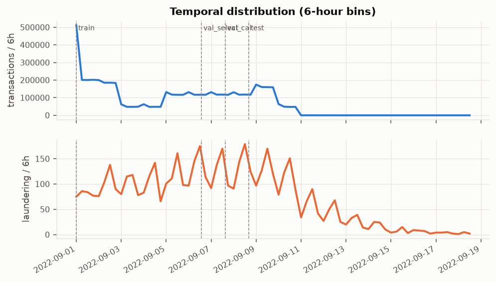
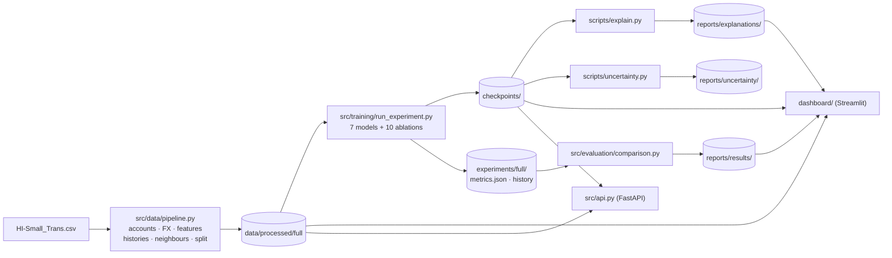
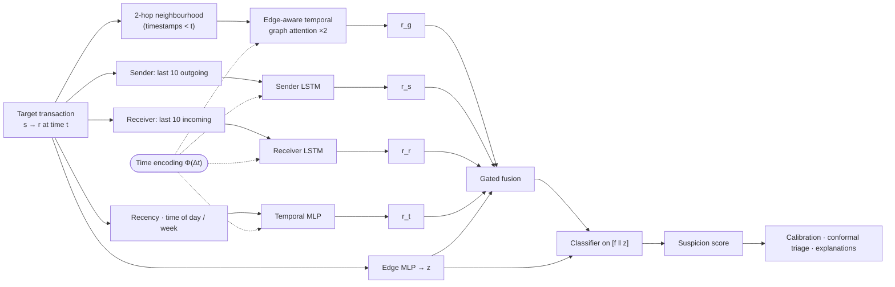
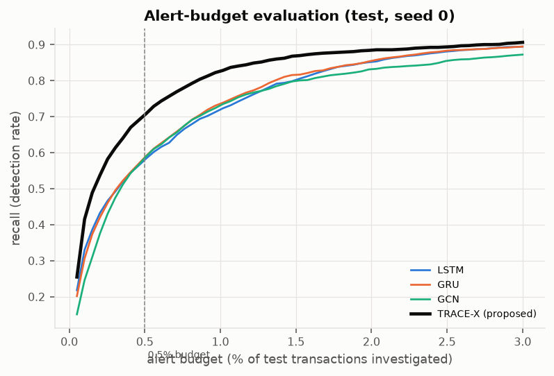

# TRACE-X

**An explainable temporal graph deep-learning framework for anti-money-laundering (AML) detection**

TRACE-X reads a large table of bank transfers and gives each transaction a **suspicion score**. It then explains the score and decides whether the case should go to a human reviewer. It is a final-year B.Tech project, trained and evaluated on the full IBM AML **HI-Small** benchmark (5,078,345 transactions) on a CPU-only laptop.

> **Responsible use.** TRACE-X produces *decision-support alerts, not proof of money laundering*. A high score, an explanation or a "confident" outcome never establishes that a crime happened. The labels used here come from a **synthetic simulator**, so they describe simulated behaviour, not real people.

Every number in this README was produced by the code in this repository. Each one can be traced to a saved file under `reports/` or `experiments/full/`. Results are reported as they came out, including where the proposed model did **not** beat a simpler baseline.

---

## Contents

1. [Overview and motivation](#1-overview-and-motivation)
2. [What AML detection means, and what this project can and cannot conclude](#2-what-aml-detection-means-and-what-this-project-can-and-cannot-conclude)
3. [Dataset](#3-dataset)
4. [Requirements and installation](#4-requirements-and-installation)
5. [Getting the data](#5-getting-the-data)
6. [The complete workflow at a glance](#6-the-complete-workflow-at-a-glance)
7. [From transactions to a temporal graph](#7-from-transactions-to-a-temporal-graph)
8. [Chronological split and leakage prevention](#8-chronological-split-and-leakage-prevention)
9. [The TRACE-X model](#9-the-trace-x-model)
10. [Baselines and fair comparison](#10-baselines-and-fair-comparison)
11. [Training](#11-training)
12. [Evaluation and results](#12-evaluation-and-results)
13. [Ablation study](#13-ablation-study)
14. [Explainability](#14-explainability)
15. [Uncertainty and human review](#15-uncertainty-and-human-review)
16. [Dashboard](#16-dashboard)
17. [API](#17-api)
18. [Docker](#18-docker)
19. [Tests](#19-tests)
20. [Repository layout](#20-repository-layout)
21. [Limitations, responsible use and future work](#21-limitations-responsible-use-and-future-work)
22. [References](#22-references)
23. [Troubleshooting](#23-troubleshooting)

---

## 1. Overview and motivation

Money laundering hides illegal money by moving it through chains of transfers that each look ordinary. A single transaction rarely looks suspicious by itself. The evidence is in **who sends money to whom**, **in what order** and **how quickly**. Rule-based monitoring misses these relational and temporal patterns and produces many false alerts. Investigators also need to know *why* something was flagged and *how confident* the system is.

TRACE-X combines three kinds of evidence about each transaction:

| Evidence | How TRACE-X reads it |
|---|---|
| The surrounding transaction network | Graph attention over the accounts' recent past transactions (2 hops) |
| Each account's recent behaviour | One LSTM over the sender's last outgoing transfers, one over the receiver's last incoming transfers |
| Timing | A learned encoding of time gaps, plus recency and time-of-day/day-of-week features |

A learned **gate** decides how much each kind of evidence counts for each transaction. Around the model, the project includes:

- six deep-learning baselines and ten ablations, all with the same inputs and budget;
- three explanation methods, with measured quality;
- uncertainty estimates that send unsure cases to a human;
- a six-page Streamlit dashboard, a FastAPI service, a Docker image and a pytest suite.

**Main results** (full test split, mean ± std over 3 seeds):

- TRACE-X reaches test PR-AUC **0.486 ± 0.039**, compared with LSTM 0.391 and the GNN baselines 0.26–0.28.
- Among the alerts it ranks in the top 0.5 % of test transactions, it finds **68 %** of the labelled laundering.
- It **ties** the simpler GAT-LSTM hybrid (0.484 ± 0.002). The difference is within seed-to-seed noise.

## 2. What AML detection means, and what this project can and cannot conclude

AML monitoring screens transactions for signs of laundering. Laundering is usually described in three stages:

1. **Placement:** illegal funds enter the financial system.
2. **Layering:** the funds move through many transfers to hide where they came from.
3. **Integration:** the funds re-enter the legitimate economy.

Typical layering patterns include fan-out and fan-in, cycles, scatter-gather, and chains through intermediaries. These are patterns of *transactions over time* between *accounts*, which is why this project combines graph learning with sequence models.

**This project can show:**

- how well different neural architectures recover the laundering patterns of a realistic simulator;
- which model components matter;
- how faithful the explanations are;
- how alerts could be ranked and triaged for review.

**This project cannot conclude:**

- that any real person or account is a criminal;
- that the measured accuracy would transfer to real bank data;
- that an explanation shows the *cause* of laundering. Explanations describe what the *model* relied on.

## 3. Dataset

| Item | Value |
|---|---|
| Source | IBM *Transactions for Anti Money Laundering (AML)*, **HI-Small** variant, on Kaggle: [`ealtman2019/ibm-transactions-for-anti-money-laundering-aml`](https://www.kaggle.com/datasets/ealtman2019/ibm-transactions-for-anti-money-laundering-aml) |
| Paper | Altman et al. (2023), NeurIPS Datasets and Benchmarks: an agent-based simulator with complete ground-truth labels |
| File used | `HI-Small_Trans.csv` (454 MB). "HI" means a *higher illicit ratio* than the "LI" variants |
| Transactions | 5,078,345 |
| Accounts / banks | 515,088 accounts (bank + account id) / 30,528 banks |
| Time span | 2022-09-01 → 2022-09-18, **minute resolution** (only 15,018 distinct timestamps) |
| Laundering transactions | 5,177 = **0.102 %**, about 1 in 980 |
| Data quality | 0 missing values; 9 exact duplicate rows (kept) |

**Schema** (raw column → name used in the code):

| Raw column | Code name | Meaning |
|---|---|---|
| Timestamp | `timestamp` / `ts` | `YYYY/MM/DD HH:MM`, converted to minutes |
| From Bank, Account | `from_bank`, `from_acct` | Sender bank code and account hex id |
| To Bank, Account.1 | `to_bank`, `to_acct` | Receiver bank code and account hex id |
| Amount Received, Receiving Currency | `amount_received`, `currency_received` | What arrived |
| Amount Paid, Payment Currency | `amount_paid`, `currency_paid` | What was sent (15 currencies) |
| Payment Format | `payment_format` | ACH, Cheque, Credit Card, Cash, Reinvestment, Wire, Bitcoin |
| Is Laundering | `label` | 1 if the simulator generated this transaction as part of a laundering pattern |

**Label meaning.** `Is Laundering = 1` means the *simulator* created the transaction as part of laundering. The labels are complete, which real data never is, but they describe synthetic behaviour.

**Class imbalance.** About 1 transaction in 980 is laundering. This is why the project uses class-weighted loss, negative resampling, and metrics that ignore the huge number of easy negatives (PR-AUC, alert-budget recall).

**Synthetic-data limitations:**

- Laundering is concentrated in the ACH payment format (0.746 % laundering rate). Reinvestment and Wire contain none.
- After 10 September the simulator produces almost only laundering. For example, 11 September has 396 transactions, of which 232 are laundering. This tail falls in the **test** period, and a model can partly exploit it; see §14.

The full profile is in [reports/profiling/profile.md](reports/profiling/profile.md), with figures in `reports/profiling/`.

<p align="center"></p>

## 4. Requirements and installation

**Hardware**

- Any 64-bit CPU. A GPU is optional: CUDA is used automatically if present, and mixed precision only on CUDA.
- About **16 GB RAM** for full mode. Dev mode needs much less.
- About **4 GB free disk**: raw CSV 0.45 GB, processed full-mode arrays 2.5 GB, dev-mode arrays 0.3 GB, checkpoints 16 MB.
- Measured reference machine: AMD Ryzen 7 5800H (8 cores), 15.4 GB RAM, no CUDA GPU.

**Software**

- Python **3.12**: tested with 3.12.9 locally and `python:3.12-slim` in Docker.
- The pinned packages in [requirements.txt](requirements.txt): PyTorch 2.14.1 (CPU), PyTorch Geometric 2.8.1, Streamlit 1.67, SHAP 0.53, MLflow 3.18, FastAPI and others.
- Optional: Docker Desktop (§18); `playwright` plus Chrome, only for re-capturing dashboard screenshots.

**Installation**

```bash
git clone https://github.com/YarimaTamang/Anti-Money-Laundering.git
cd Anti-Money-Laundering
python -m venv .venv
source .venv/bin/activate            # Windows: .venv\Scripts\activate
pip install -r requirements.txt      # CPU-only PyTorch: add --extra-index-url https://download.pytorch.org/whl/cpu
```

**Environment variables.** Copy [.env.example](.env.example) to `.env` if you need any of these. All are optional, and `.env` is git-ignored.

| Variable | Purpose |
|---|---|
| `KAGGLE_USERNAME`, `KAGGLE_KEY` | Kaggle credentials, only if anonymous download fails. Never hard-code them |
| `TRACEX_RAW_FILE` | Absolute path to a manually downloaded `HI-Small_Trans.csv` |
| `TRACEX_DATA_DIR` | Where processed arrays are stored (default `data/processed`) |

## 5. Getting the data

The preprocessing step finds the CSV automatically. [src/data/download.py](src/data/download.py) looks in this order:

1. the path in `TRACEX_RAW_FILE`;
2. `data/raw/HI-Small_Trans.csv` (manual download);
3. an automatic download with `kagglehub`. The dataset is public, so this usually works without credentials. The file is cached in `~/.cache/kagglehub/`.

To download manually: get `HI-Small_Trans.csv` from the Kaggle page above and put it in `data/raw/`.

**Where data is stored:**

| Location | Contents | In git? |
|---|---|---|
| `data/raw/` | Raw CSV, if downloaded manually | No |
| `data/processed/dev/` | Arrays for the 600,000-row chronological prefix, used by the tests | No |
| `data/processed/full/` | Arrays for all 5,078,345 transactions | No |
| `checkpoints/<mode>/<experiment>/seed<k>.pt` | Trained model weights | No |

The dataset is not redistributed in this repository.

## 6. The complete workflow at a glance

Run every command from the project root. [scripts/reproduce.sh](scripts/reproduce.sh) runs the same steps in order.

| # | Step | Command | What it does | Time on the reference laptop |
|---|---|---|---|---|
| 1 | Preprocess (dev) | `python -m src.data.pipeline --mode dev` | Builds features for the first 600k transactions, used by the tests | short |
| 2 | Preprocess (full) | `python -m src.data.pipeline --mode full` | Reads the CSV, builds accounts, features, histories, neighbour tables and splits; caches them in `data/processed/full` | about 3 min |
| 3 | Profile | `python -m src.data.profiling --mode full` | Writes `reports/profiling/` (statistics and figures) | minutes |
| 4 | Dev checkpoint | `python -m src.training.run_experiment --exp tracex --seed 0 --mode dev --max-epochs 1 --neg-per-epoch 5000` | Tiny 1-epoch model needed by the explainability tests | minutes |
| 5 | Tests | `python -m pytest tests -q` | 41 tests (§19) | about 1 min |
| 6 | Train one model | `python -m src.training.run_experiment --exp tracex --seed 0 --mode full` | Trains, selects the threshold, calibrates, tests once, saves everything | 1–1.5 h for TRACE-X |
| 7 | Train all | `python scripts/run_queue.py --exps tracex,lstm,gru,gcn,graphsage,gat,gat_lstm --seeds 0,1,2` | Runs many experiments in sequence, skipping finished ones | about 1–2 days on CPU |
| 8 | Compare | `python -m src.evaluation.comparison --mode full` | Writes result tables and figures to `reports/results/` | seconds |
| 9 | Explain | `python scripts/explain.py --exp tracex --seed 0 --stability-seeds 1,2` | Writes 10 explained cases, quality metrics and global SHAP to `reports/explanations/` | about 1 h |
| 10 | Uncertainty | `python scripts/uncertainty.py --exp tracex --seed 0` | Conformal triage and MC dropout, to `reports/uncertainty/` | under 1 h |
| 11 | Efficiency | `python scripts/benchmark_efficiency.py` | Times each model alone; run on an idle machine | about 20 min |
| 12 | Dashboard | `streamlit run dashboard/app.py` | Interactive investigator UI at http://localhost:8501 | — |
| 13 | API | `uvicorn src.api:app --port 8000` | REST endpoints (§17) | — |

Times marked "short" or "minutes" were not timed precisely. Steps 6–11 need the full-mode data from step 2.



## 7. From transactions to a temporal graph

**Accounts are nodes.** An account is identified by `bank_code + "_" + account_hex`, for example `0223_812D1A410`. The hex id alone is not unique: 515,080 hex strings versus 515,088 (bank, account) pairs.

**Transactions are directed, time-stamped edges** from sender to receiver. Self-transfers are kept (11.6 % of rows) and flagged. Multiple transfers between the same pair are separate edges.

**Currency.** Amounts come in 15 currencies. Exchange rates to USD are estimated from **training rows only**, as the median ratio over cross-currency transfers.

**Transaction (edge) features, 27 columns** ([src/graph/features.py](src/graph/features.py)):

- `log1p` USD amount and `log1p` original amount, standardised using training statistics;
- payment format one-hot (7 columns) and payment currency one-hot (15 columns);
- cross-bank, currency-conversion and self-loop flags (3 columns).

**Account (node) state, 11 features, computed strictly before each transaction:**

- outgoing and incoming counts (log);
- outgoing and incoming USD volume (log);
- mean outgoing and incoming amount (log);
- distinct receivers and distinct senders (log);
- transactions per hour since first appearance (log);
- minutes since last activity (log);
- a has-history flag.

**Transaction histories** ([src/sequences/histories.py](src/sequences/histories.py)):

- For a transaction from sender *s* to receiver *r* at time *t*: the last *L* **outgoing** transfers of *s* and the last *L* **incoming** transfers of *r*, all strictly before *t*.
- L = 10 by default (5 and 20 are tested in ablations; up to 20 are stored).
- Each step has 28 features: the 27 edge features plus a "same counterparty as the target" flag, which captures repeated transfers. Each step also carries two time gaps: minutes to the target and minutes to the previous step.

**Temporal neighbourhood** ([src/graph/construction.py](src/graph/construction.py), [src/graph/temporal_graph.py](src/graph/temporal_graph.py)):

- For each transaction and each endpoint, the 10 most recent earlier transactions touching that account are stored.
- Each neighbour list is itself causal with respect to *its own* time, so the lists can be expanded recursively into a 2-hop computation tree: 10 first-hop and 10×5 second-hop neighbours per endpoint. No future information enters at any depth.
- `TemporalGraphStore` builds these subgraphs on the fly for each mini-batch.

## 8. Chronological split and leakage prevention

**Split.** Transactions are ordered by time and split by count. Each boundary is moved to the next timestamp change, so no minute is shared by two splits.

| Split | Transactions | Laundering | Period | Used for |
|---|---|---|---|---|
| train (60 %) | 3,047,216 | 2,299 | 09-01 00:00 → 09-06 13:36 | gradient updates, FX rates, feature scaling |
| val_select (10 %) | 508,115 | 558 | 09-06 13:37 → 09-07 14:56 | early stopping, model selection, alert threshold |
| val_cal (10 %) | 507,450 | 523 | 09-07 14:57 → 09-08 16:12 | probability calibration, conformal calibration |
| test (20 %) | 1,015,564 | 1,797 | 09-08 16:13 → 09-18 16:18 | **scored once**, after every choice was fixed |

**Identical timestamps.** Timestamps have minute resolution, and 99.7 % of transactions share their minute with another transaction. The order of rows within a minute is not a real event order. TRACE-X therefore treats **same-minute transactions as simultaneous**: everything used to score a transaction at time *t* comes only from transactions with timestamp **strictly less than t**. That includes account states, histories and neighbours at every depth.

**How it is implemented** ([src/graph/causal_index.py](src/graph/causal_index.py)):

1. Rows are sorted by (account, timestamp).
2. For each row, `gs` is the first row of its account and `bs` is the first row of its (account, timestamp) block.
3. The range `[gs, bs)` is then exactly the account's strictly-earlier rows.
4. Counts, sums, histories and neighbour lists are prefix sums or windows over that range. The code is fully vectorised; full preprocessing takes about 3 minutes.

**Other leakage guards:**

- Labels are never used as features.
- Feature scaling and FX rates are fitted on training rows only.
- The decision threshold is chosen on val_select, and calibration is fitted on val_cal.
- The test split is predicted once per run.

**Leakage tests.** [tests/test_leakage.py](tests/test_leakage.py) has 11 tests. They compare the vectorised code with brute-force implementations on synthetic data with many timestamp ties, and check that features never depend on later rows.

## 9. The TRACE-X model

**In plain language.** For each transaction, TRACE-X builds four summaries:

1. a **graph summary** of the accounts' recent transaction neighbourhood;
2. a **sender summary** of how the sender has been paying out;
3. a **receiver summary** of how the receiver has been receiving;
4. a **timing summary** of how recently each account was active, and when the transaction happens.

A small network looks at all four plus the transaction itself and outputs **gates**: numbers between 0 and 1 saying how much each summary should count *for this transaction*. The weighted mix goes to a classifier that outputs the suspicion score. The model has 238,369 parameters ([src/models/main_model.py](src/models/main_model.py), [src/models/layers.py](src/models/layers.py)).

**Time encoding.** A time gap Δt in minutes becomes a 16-dimensional vector with learnable frequencies ω and phases φ (as in TGAT, Xu et al. 2020):

$$\Phi(\Delta t) = \cos(\omega\,\Delta t + \varphi)$$

**Edge-aware temporal graph attention** (2 layers, 4 heads, hidden size 64). A neighbour *j* sends account *i* a message along a past transaction with attributes $a_{ij}$, direction $d_{ij}$ and time gap $\Delta t_{ij}$. Let $u_{ij} = [a_{ij}\,\Vert\,d_{ij}\,\Vert\,\Phi(\Delta t_{ij})]$. Then:

$$e^{h}_{ij} = \mathbf{a}_h^{\top}\,\mathrm{LeakyReLU}\big(W^{h}_{q}x_i + W^{h}_{k}x_j + W^{h}_{e}u_{ij}\big), \qquad \alpha^{h}_{ij} = \mathrm{softmax}_{j \in \mathcal N_{<t}(i)}\big(e^{h}_{ij}\big)$$

$$x_i' = \mathrm{LayerNorm}\Big(x_i + \mathrm{ELU}\big(W_s x_i + \big\Vert_{h} \textstyle\sum_{j} \alpha^{h}_{ij}\,(W^{h}_{v}x_j + W^{h}_{u}u_{ij})\big)\Big)$$

This is GATv2-style scoring (Brody et al., 2022) over the causal neighbourhood $\mathcal N_{<t}$. The graph summary is $r_g = \mathrm{ReLU}(W[x'_{\text{sender}} \Vert x'_{\text{receiver}}])$.

**Sender and receiver LSTMs.** These are two separate LSTMs. Each step's input is the step features plus Φ(time to target) plus Φ(time to previous step):

$$i_\tau, f_\tau, o_\tau = \sigma(W x_\tau + U h_{\tau-1} + b), \quad c_\tau = f_\tau \odot c_{\tau-1} + i_\tau \odot \tanh(W_c x_\tau + U_c h_{\tau-1} + b_c), \quad h_\tau = o_\tau \odot \tanh(c_\tau)$$

The final hidden states are $r_s$ (sender) and $r_r$ (receiver). An empty history gives a zero vector.

**Temporal branch.** $r_t$ = MLP(Φ(time since the sender's last activity), Φ(time since the receiver's last activity), has-history flags, sin/cos time of day, sin/cos day of week).

**Gated fusion and output.** $z$ = MLP(target transaction features):

$$g_k = \sigma\big(W^{k}_{g}[r_g \Vert r_s \Vert r_r \Vert r_t \Vert z] + b^{k}_{g}\big), \qquad f = \sum_{k\in\{g,s,r,t\}} g_k \odot \tanh(W_k r_k + b_k), \qquad \text{score} = \sigma\big(\mathrm{MLP}([f \Vert z])\big)$$



**What is borrowed and what is new.**

- **Borrowed:** graph attention (Veličković et al., 2018), GATv2 scoring (Brody et al., 2022) and the cosine time encoding of TGAT (Xu et al., 2020).
- **This project's design:** combining edge-aware temporal attention over a causal 2-hop neighbourhood, direction-specific sender and receiver LSTMs, a temporal branch, and transaction-conditioned element-wise gating.

TRACE-X is **not** a reproduction of any published Temporal Graph Attention Network or TGN model. Attention weights are internal signals and are **not** presented as explanations.

## 10. Baselines and fair comparison

Each baseline answers one question. No classical ML classifiers are used.

| Model | Question it answers | Params |
|---|---|---|
| LSTM | How far do account histories alone get? | 42,945 |
| GRU | Does a simpler recurrent cell do as well? | 36,801 |
| GCN | How far does the transaction graph alone get, with a basic convolution? (no edge attributes) | 27,713 |
| GraphSAGE | Graph alone with mean-aggregation sampling? (no edge attributes) | 35,905 |
| GAT | Graph alone with attention and edge attributes (amount, format, direction, log Δt)? | 31,809 |
| GAT-LSTM | Is a *simple* graph+sequence hybrid (concatenation, no gating, no temporal branch) enough? | 64,577 |
| **TRACE-X** | Proposed model | 238,369 |

LSTM and GRU share one recurrent encoder for both histories. The GNNs use PyTorch Geometric layers over the **same** causal 2-hop subgraph as TRACE-X. All the baselines are configurations of the classes in [src/models/baselines.py](src/models/baselines.py) (see [src/models/registry.py](src/models/registry.py)).

**How fairness is kept:**

- **Same data:** identical splits, the same causal inputs and the same target-transaction embedding.
- **Same budget:** hidden size 64, optimiser, loss, negative sampling, epoch budget and early-stopping rule.
- **Same selection:** threshold chosen on val_select and calibration fitted on val_cal.
- **Same reporting:** test scored once, 3 seeds per model, mean ± std reported.

## 11. Training

**Configuration** ([configs/training.yaml](configs/training.yaml), [configs/models.yaml](configs/models.yaml)):

| Setting | Value |
|---|---|
| Optimiser | AdamW, learning rate 1e-3, weight decay 1e-4, gradient clipping 1.0 |
| Scheduler | ReduceLROnPlateau on validation PR-AUC (factor 0.5, patience 1) |
| Epochs | at most 20; early stopping with patience 3 on val_select PR-AUC; best checkpoint restored |
| Batches | 1,024 (training), 4,096 (evaluation) |
| Class imbalance | Each epoch: all 2,299 training positives + 150,000 freshly sampled negatives. BCE with `pos_weight = n_neg / n_pos` ≈ 65. Focal loss is available (`tracex_focal` experiment, not run) |
| Validation | All val_select positives + a fixed sample of 50,000 negatives, re-weighted by inverse sampling rate (a unit test checks the estimate is unbiased) |
| Inputs | history length 10; 10 hop-1 and 5 hop-2 neighbours |
| Seeds | 0, 1, 2 for every model |
| Mixed precision | Only on CUDA (no benefit on this CPU) |

**Model selection, per run:**

1. Keep the epoch with the best val_select PR-AUC.
2. Choose the alert threshold that maximises F1 on val_select.
3. Fit Platt scaling on val_cal.
4. Predict the full test split once.

**Commands:**

```bash
# one run (any experiment name from configs/models.yaml)
python -m src.training.run_experiment --exp tracex --seed 0 --mode full
#   options: --max-epochs N  --neg-per-epoch N  --threads N
#   --eval-only : re-evaluate an existing checkpoint (used when a run was interrupted after training)

# a queue of runs (resumable: skips runs that already have metrics.json)
python scripts/run_queue.py --exps tracex,lstm,gru,gcn,graphsage,gat,gat_lstm --seeds 0,1,2
```

**Outputs of each run:**

- `checkpoints/full/<exp>/seed<k>.pt`: weights plus everything needed to rebuild the model;
- `experiments/full/<exp>/seed<k>/`: `config.yaml`, `history.csv` (per-epoch loss and validation PR-AUC), `metrics.json` (all test metrics) and `train.log`;
- MLflow records of configuration, seed, metrics, duration and checkpoint path, in `experiments/mlflow/mlflow.db`. View them with:
  ```bash
  mlflow ui --backend-store-uri sqlite:///experiments/mlflow/mlflow.db
  ```

**What was actually run.** 35 full-dataset runs:

- 7 models × 3 seeds;
- 10 ablations with seed 0;
- 4 of those ablations also with seed 1.

Two runs were interrupted when the session ended:

- `abl_graph_only` seed 1 was re-evaluated from its saved best checkpoint with `--eval-only`;
- `abl_no_temporal_enc` seed 1 was retrained from scratch.

The wall-clock times of TRACE-X seed 0 and LSTM seed 1 are excluded (`TIMING_INVALID.txt`) because the laptop slept during those runs; their metrics are unaffected.

## 12. Evaluation and results

**Metrics** ([src/evaluation/](src/evaluation/)). All metrics are computed on the **complete** test split: 1,015,564 transactions, 1,797 laundering.

- **PR-AUC** (average precision) is the main metric. With 0.1 % positives, ROC-AUC is about 0.99 for every model and does not separate them.
- **Precision, recall, F1** at the threshold that maximised F1 on val_select.
- **Alert budget.** Rank all test transactions by score and pretend investigators can review the top K = b × N_test.
  - Precision@K = laundering found / K.
  - Recall@K = laundering found / all 1,797 laundering.
  - At b = 0.5 %, K = 5,078 alerts. Since there are only 1,797 positives, P@0.5 % can be at most 0.354.
- **Calibration.** Brier score, ECE (15 bins) and a reliability diagram, before and after Platt scaling (fitted on val_cal).
- **Efficiency.** Parameters, throughput, single-transaction latency (including causal subgraph construction) and peak memory.

**Model comparison** ([reports/results/results_models.md](reports/results/results_models.md); mean ± std over **3 seeds**):

| Model | ROC-AUC | **PR-AUC** | Precision | Recall | F1 | P@0.5 % | R@0.5 % |
|---|---|---|---|---|---|---|---|
| LSTM | 0.9873 ± 0.0001 | 0.3907 ± 0.0085 | 0.3311 ± 0.0306 | 0.4485 ± 0.0256 | 0.3790 ± 0.0137 | 0.2041 ± 0.0019 | 0.5769 ± 0.0054 |
| GRU | 0.9878 ± 0.0004 | 0.3810 ± 0.0142 | 0.4043 ± 0.0152 | 0.3882 ± 0.0204 | 0.3957 ± 0.0134 | 0.2099 ± 0.0026 | 0.5932 ± 0.0075 |
| GCN | 0.9845 ± 0.0006 | 0.2764 ± 0.0123 | 0.2768 ± 0.0167 | 0.4389 ± 0.0561 | 0.3368 ± 0.0090 | 0.1998 ± 0.0075 | 0.5646 ± 0.0211 |
| GraphSAGE | 0.9860 ± 0.0002 | 0.2751 ± 0.0159 | 0.2796 ± 0.0493 | 0.4786 ± 0.0829 | 0.3428 ± 0.0101 | 0.2116 ± 0.0011 | 0.5980 ± 0.0030 |
| GAT | 0.9843 ± 0.0008 | 0.2636 ± 0.0345 | 0.2489 ± 0.0300 | 0.4808 ± 0.0283 | 0.3267 ± 0.0275 | 0.2026 ± 0.0118 | 0.5726 ± 0.0332 |
| GAT-LSTM | **0.9895 ± 0.0002** | 0.4843 ± 0.0020 | 0.4248 ± 0.0158 | **0.4981 ± 0.0138** | 0.4580 ± 0.0047 | 0.2352 ± 0.0035 | 0.6646 ± 0.0100 |
| **TRACE-X** | 0.9890 ± 0.0007 | **0.4857 ± 0.0386** | **0.4554 ± 0.0603** | 0.4945 ± 0.0182 | **0.4721 ± 0.0362** | **0.2404 ± 0.0066** | **0.6795 ± 0.0186** |

TRACE-X per seed: PR-AUC 0.5391 / 0.4495 / 0.4683. Seeds 1 and 2 early-stopped at epochs 3 and 4.

**How to read the comparison:**

- **Account histories matter most.** Every model that sees histories beats every graph-only GNN by about 0.1–0.2 PR-AUC.
- **Hybrids are best.** GAT-LSTM and TRACE-X beat LSTM by about 0.09 PR-AUC and lead at every alert budget.
- **TRACE-X and GAT-LSTM are a statistical tie on PR-AUC.**
  - TRACE-X has the best mean F1 and alert-budget scores, and the best single run (0.539).
  - It is much less stable across seeds (± 0.039 vs ± 0.002), so with 3 seeds it cannot be called significantly better.
  - It is also 3.7× larger.

**TRACE-X seed 0 in operational terms** (`experiments/full/tracex/seed0/metrics.json`):

- At its val-selected threshold (0.9985): 921 true positives, 828 false positives, 876 missed, 1,012,939 true negatives. Precision 0.527, recall 0.513.
- As alert budgets:

| Alert budget | Alerts K | Precision@K | Recall@K |
|---|---|---|---|
| 0.1 % | 1,016 | 0.729 | 0.412 |
| 0.5 % | 5,078 | 0.250 | 0.705 |
| 1 % | 10,156 | 0.146 | 0.826 |
| 2 % | 20,312 | 0.078 | 0.885 |

**Calibration.**

- Raw scores are badly calibrated, as expected after training with `pos_weight` ≈ 65 on resampled data. TRACE-X raw (mean over seeds): Brier 0.068, ECE 0.097.
- Platt scaling fixes this: Brier 0.00123, ECE 0.0006.
- Figure: [calibration_tracex.png](reports/results/figures/calibration_tracex.png).

**Efficiency** ([reports/results/efficiency_benchmark.md](reports/results/efficiency_benchmark.md)). Each model was run alone, 8 CPU threads, identical batches, one run each:

| Model | Params | Train samples/s | Inference tx/s | Latency median / p95 (ms) | Peak memory (MB) |
|---|---|---|---|---|---|
| LSTM | 42,945 | 1,311 | 15,775 | 6.1 / 11.3 | 1,178 |
| GRU | 36,801 | 7,286 | 22,134 | 3.4 / 3.8 | 1,155 |
| GCN | 27,713 | 754 | 2,200 | 8.7 / 27.2 | 2,614 |
| GraphSAGE | 35,905 | 2,473 | 2,744 | 2.9 / 6.2 | 2,404 |
| GAT | 31,809 | 1,147 | 1,459 | 6.3 / 7.7 | 2,814 |
| GAT-LSTM | 64,577 | 1,004 | 1,356 | 8.8 / 11.5 | 2,953 |
| TRACE-X | 238,369 | 1,176 | 1,568 | 11.3 / 17.3 | 3,070 |

Latency includes building the transaction's causal history and subgraph. Training times recorded during the experiment queues are in `results_models.md`. They are only indicative, because two jobs often shared the CPU.

<p align="center"></p>
<p align="center"> </p>

## 13. Ablation study

**Purpose.** Each ablation changes one part of TRACE-X to see whether that part helps. It uses the same data and budget, and is defined in `configs/models.yaml`.

**Completed seeds.** Because of the CPU budget:

- every ablation ran with seed 0;
- the four key ones (sequence-only, graph-only, concat fusion, no temporal encoding) also ran with seed 1.

**Single-seed rows are marked (1).** TRACE-X itself varies by about ± 0.04 PR-AUC between seeds. Each ablation is therefore compared with the TRACE-X run of the **same seed** ("paired Δ"), and differences under about 0.04 should be treated as noise.

| Variant | Seeds | PR-AUC | F1 | R@0.5 % | Paired ΔPR-AUC |
|---|---|---|---|---|---|
| **TRACE-X (full)** | 3 | 0.4857 ± 0.0386 | 0.4721 ± 0.0362 | 0.6795 ± 0.0186 | — |
| Sequence branches only | 2 | 0.4573 ± 0.0015 | 0.4693 ± 0.0011 | 0.6297 ± 0.0075 | −0.037 |
| Graph branch only | 2 | 0.4812 ± 0.0200 | 0.4747 ± 0.0261 | 0.6728 ± 0.0017 | −0.013 |
| No learnable time encoding | 2 | 0.4970 ± 0.0162 | 0.4698 ± 0.0214 | 0.6664 ± 0.0003 | +0.003 |
| No edge features in the graph | **1** | 0.5669 | 0.5470 | 0.7034 | +0.028 |
| Mean aggregation instead of attention | **1** | 0.3049 | 0.3268 | 0.5537 | −0.234 |
| No sender history | **1** | 0.5285 | 0.5107 | 0.7140 | −0.011 |
| No receiver history | **1** | 0.5297 | 0.5052 | 0.6989 | −0.009 |
| Concatenation instead of gated fusion | 2 | 0.4175 ± 0.0052 | 0.4299 ± 0.0030 | 0.6784 ± 0.0033 | −0.077 |
| Sequence length 5 (default 10) | **1** | 0.5538 | 0.5107 | 0.7257 | +0.015 |
| Sequence length 20 | **1** | 0.5404 | 0.5180 | 0.7245 | +0.001 |

Source: [reports/results/results_ablation.md](reports/results/results_ablation.md).

**Findings:**

- **Gated fusion is the only component with a consistent effect.** Replacing it with concatenation lowered PR-AUC on both seeds: 0.412 vs 0.539, and 0.423 vs 0.450.
- **Combining graph and sequences helps on average, but not on every seed.** Single-branch variants are about 0.08 lower on seed 0 but slightly higher on seed 1, where TRACE-X stopped at epoch 3.
- **Not conclusive:** mean aggregation (−0.23). This single run peaked at epoch 1, which looks like an optimisation failure.
- **Neutral within noise:** the time encoding, graph edge features, removing one history branch, and sequence length 5 or 20.
- **A clear side result:** TRACE-X's graph branch alone (0.481) is far stronger than the GNN baselines (0.26–0.28). Edge attributes, direction and time-aware messages over the causal neighbourhood matter more than the choice of GNN.
- **The main weakness of TRACE-X is seed instability, not missing capacity.**

## 14. Explainability

Three methods are applied to the **trained TRACE-X model** (seed 0), using the same inputs and forward pass as the prediction ([src/explainability/](src/explainability/), [scripts/explain.py](scripts/explain.py)):

| Method | What it explains | How it is computed |
|---|---|---|
| **Kernel SHAP** (Lundberg & Lee, 2017) | 31 readable features: transaction attributes, sender and receiver account state, time | `shap.KernelExplainer` with a background of 12 training transactions. Histories and neighbourhood are held fixed. Additivity is checked |
| **Integrated Gradients** (Sundararajan et al., 2017) | Each past transaction in the sender and receiver histories | 64-step integral from a zero baseline. Completeness is checked |
| **GNNExplainer**, adapted (Ying et al., 2019) | Which neighbouring past transactions, and which edge and node features, the graph branch uses | Learns soft masks on messages inside the attention layer |

**Measured quality** on 10 test cases (5 true positives, 2 false positives, 2 false negatives, 1 true negative). Fidelity is measured in logit units. It is the drop in the model's logit when the top-k elements are deleted, compared with deleting k random elements ([reports/explanations/quality.json](reports/explanations/quality.json)).

| Method | Top-k vs random-k drop | Sparsity | Stability across seeds (Spearman ρ, 12 pairs) | Sanity check |
|---|---|---|---|---|
| Kernel SHAP | **9.94** vs 0.68 | top-5 features carry 83 % | 0.68 ± 0.15 | additivity gap 2e-7 |
| Integrated Gradients | **0.89** vs 0.29 | top-3 steps carry 41 % | 0.68 ± 0.25 | completeness error 0.001 |
| GNNExplainer | −0.03 vs 0.01 | no edge mask > 0.5 | 0.996 (artefact, see below) | — |

**What this means:**

- **SHAP and IG are faithful.** Removing what they rank highest changes the score far more than removing random elements. Independently trained seeds mostly agree on the main drivers.
- **Global drivers.** By mean |SHAP| over 40 test transactions, the most important features are payment format, USD amount and the sender's minutes since last activity. This matches the data profile (§3).
- **GNNExplainer found no sparse graph explanation.** Its masks are nearly uniform, which is also why its "stability" looks perfect. Investigator reports therefore show an automatic caution and **must not** be read as naming accomplices.
- **Possible shortcut.** `day_of_week` pushes several alerts up. In this benchmark the late test days are mostly laundering, so the model may partly exploit a simulator artefact.

**Limitations.**

- SHAP holds histories and neighbourhood fixed, so it only explains tabular features.
- IG depends on its baseline.
- None of the methods shows causation.

## 15. Uncertainty and human review

Source: [reports/uncertainty/uncertainty.md](reports/uncertainty/uncertainty.md). Model: TRACE-X seed 0.

**Class-conditional split conformal prediction** ([src/uncertainty/conformal.py](src/uncertainty/conformal.py)) is calibrated on val_cal. The error rates are fixed in advance as a policy: α = 0.01 for normal transactions and α = 0.1 for laundering. Each test transaction gets a *prediction set*:

- {normal} → **confident normal**;
- {suspicious} → **confident suspicious alert**;
- both or neither → **human review**.

| Full test split | Value |
|---|---|
| Coverage of normal transactions (target 0.99) | 0.9737 |
| Coverage of laundering (target 0.90) | 0.9432 |
| Confident normal / confident suspicious / human review | 92.9 % / 2.78 % / 4.35 % |

Coverage for normal transactions fell **below its target**. The calibration period comes before the test period, so the data drifts and the conformal guarantee does not fully hold. This is reported rather than hidden.

**MC Dropout** ([src/uncertainty/mc_dropout.py](src/uncertainty/mc_dropout.py)): 20 stochastic passes on a weighted test subsample.

- A case is sent to review when its predictive standard deviation exceeds the 95th percentile on val_cal. This applies to 8.0 % of transactions.
- The standard deviation identifies the model's mistakes with AUROC **0.813**, so its uncertainty is informative.

## 16. Dashboard

```bash
streamlit run dashboard/app.py      # opens http://localhost:8501
```

The dashboard needs `data/processed/full`, `checkpoints/full/tracex/seed0.pt` and the `reports/` folder. It uses the dark navy theme in `.streamlit/config.toml`, and every page shows the disclaimer.

| Page | What you can do |
|---|---|
| **Overview** | Dataset and test KPIs, transactions and laundering per day, payment formats, test score distribution, model summary, highest-risk test transactions |
| **Transaction Investigation** | Look up one transaction: score, calibrated probability, conformal outcome, the sender and receiver histories fed to the LSTMs, IG and SHAP explanations |
| **Network Explorer** | Bounded 2-hop ego network around an account, coloured by model score (or by benchmark label) |
| **Explainable AI** | Global SHAP, local explanations for the 10 explained cases, explanation-quality metrics |
| **Model Laboratory** | Baseline and ablation charts, training curves, efficiency |
| **Investigation Reports** | Generate and download (Markdown or HTML) an investigator report for any transaction |

**How to search a transaction.**

1. Open *Transaction Investigation*.
2. In the left sidebar, either pick one of the **Explained cases** or type a **Transaction ID**.

The transaction ID is the row index in the original CSV (`tx_id`), for example `4723792`. Transactions outside the test period can be viewed, but the page warns that the model was trained or tuned on them. Model-based pages take about 10–20 s on first load while the model and data load.

**How to read an investigation report** (example: [reports/explanations/cases/4723765.md](reports/explanations/cases/4723765.md)):

| Section | Meaning |
|---|---|
| Transaction | Amount, currency, format, suspicion score and Platt-calibrated probability |
| Historical behaviour | Sender and receiver activity **strictly before** this transaction |
| Important connected accounts | GNNExplainer's neighbours. With a *Caution* line, the graph evidence is diffuse and these are not specific suspects |
| Feature contributions | SHAP values in logit units: positive pushes towards "suspicious", negative towards "normal" |
| Main explanation findings | Plain-language summary: threshold, top SHAP features, most influential past transactions (IG), conformal outcome |
| Benchmark label | The simulator's label. Shown for evaluation only, it is not a verdict |

## 17. API

```bash
uvicorn src.api:app --port 8000
```

The API serves TRACE-X seed 0 on the full-mode data ([src/api.py](src/api.py)).

| Endpoint | Returns |
|---|---|
| `GET /health` | `{"status": "ok"}` |
| `GET /predict/{tx_id}` | score, calibrated probability, alert flag, threshold, split, disclaimer |
| `GET /explain/{tx_id}` | Integrated Gradients attributions over the sender and receiver histories |
| unknown `tx_id` | HTTP 404 |

Example (a verified response):

```bash
curl http://localhost:8000/predict/4723765
# {"tx_id":4723765,"split":"test","score":0.99994611...,"calibrated_probability":0.89716888...,
#  "alert":true,"threshold":0.99851185...,"disclaimer":"Decision-support alert, not proof of money laundering."}
```

Interactive documentation is at http://localhost:8000/docs.

## 18. Docker

The image contains the code and dependencies only (CPU PyTorch, about 2.8 GB). Data, checkpoints, experiments and reports are **mounted** at run time.

```bash
docker build -t tracex .

# dashboard  -> http://localhost:8501
docker run -p 8501:8501 \
  -v "$PWD/data:/app/data" -v "$PWD/checkpoints:/app/checkpoints" \
  -v "$PWD/experiments:/app/experiments" -v "$PWD/reports:/app/reports" tracex

# API        -> http://localhost:8000
docker run -p 8000:8000 \
  -v "$PWD/data:/app/data" -v "$PWD/checkpoints:/app/checkpoints" \
  -v "$PWD/experiments:/app/experiments" -v "$PWD/reports:/app/reports" \
  tracex uvicorn src.api:app --host 0.0.0.0 --port 8000
```

In Windows PowerShell, use `${PWD}` instead of `$PWD`.

**Verified on 18 Nov 2026** with Docker Desktop 29.9.3:

- the image built;
- all six dashboard pages loaded without errors;
- the API returned the same prediction as the non-Docker run, and 404 for unknown IDs.

## 19. Tests

```bash
python -m pytest tests -q
```

**Most recent verified result (20 Nov 2026): 41 passed, 0 failed** in about 50 s.

| File | Tests | What it checks |
|---|---|---|
| `test_leakage.py` | 11 | Histories, account states and neighbours match brute force; same-minute transactions never leak; splits are chronological and do not cut a timestamp; scalers use training rows only; labels are not features |
| `test_models.py` | 21 | Output shapes and forward/backward passes for every model and ablation; depth-pruning equivalence; checkpoint save and restore; prediction consistency |
| `test_training.py` | 3 | Training never touches the test split; threshold and metrics; the weighted validation estimate matches full-population metrics |
| `test_explainability.py` | 6 | IG completeness; GNNExplainer masks are valid and causal; SHAP wrapper reproduces the model and is additive; masked forward = normal forward; conformal per-class coverage; MC dropout produces variance |

The tests need the dev-mode artefacts (§6, steps 1 and 4). Without them, the dependent tests are **skipped**, not failed. The run reports them as `s`.

## 20. Repository layout

```
Anti-Money-Laundering/
├── README.md                  this guide
├── requirements.txt           pinned dependencies
├── Dockerfile, .dockerignore  container for the dashboard / API
├── .env.example               optional environment variables (no secrets committed)
├── .streamlit/config.toml     dashboard theme
│
├── configs/                   data.yaml · training.yaml · models.yaml (all experiments and ablations)
├── src/
│   ├── data/                  download, preprocessing, profiling, pipeline (CLI)
│   ├── graph/                 causal index, edge/account features, neighbour tables, TemporalGraphStore
│   ├── sequences/             sender/receiver histories, time encoding
│   ├── models/                layers, TRACE-X (main_model.py), baselines, registry
│   ├── training/              trainer, losses, checkpoints, run_experiment (CLI)
│   ├── evaluation/            metrics, alert budget, calibration, comparison (CLI)
│   ├── explainability/        SHAP, Integrated Gradients, GNNExplainer, fidelity, reports
│   ├── uncertainty/           conformal prediction, MC dropout
│   ├── utils/                 config, logging, plotting, reproducibility
│   └── api.py                 FastAPI service
├── dashboard/                 Streamlit app: app.py, pages/, components/
├── scripts/                   run_queue, explain, uncertainty, benchmark_efficiency, screenshots, reproduce.sh
├── tests/                     pytest suite
│
├── reports/                   generated results (committed)
│   ├── profiling/  results/  explanations/  uncertainty/  dashboard_screenshots/
├── experiments/full/          per run: config.yaml, history.csv, metrics.json, train.log (committed)
├── docs/
│   ├── completion_report.md   implementation and verification status (sections A–I)
│   └── presentation/          10-slide project presentation (.pptx)
│
└── git-ignored, created locally:
    data/  checkpoints/  experiments/dev/  experiments/mlflow/  experiments/**/*.npy|*.npz
```

## 21. Limitations, responsible use and future work

**Limitations:**

- **Synthetic data.** Results measure how well models learn the simulator's typologies, not real-world performance. The laundering-heavy tail of the test period is an artefact a model may exploit.
- **Class imbalance.** At its operating threshold, about half of TRACE-X's alerts are false positives. Every alert still needs human review.
- **Compute.** Training was CPU only. There was no hyper-parameter search, ablations have 1–2 seeds, and TRACE-X varies a lot between seeds. Its tie with GAT-LSTM cannot be resolved with 3 seeds.
- **Temporal generalisation.** There is a single chronological split. Conformal coverage for normal traffic fell below target, a sign of drift.
- **Explainability.** GNNExplainer graph masks were uninformative, and SHAP and IG are only moderately stable across seeds. None of the methods shows causation.
- **Deployment.** The model has not been validated on real data, and there is no governance, privacy review or drift monitoring.

**Responsible use.**

- TRACE-X is a research prototype for **decision support**.
- It must not trigger automatic action against customers.
- Its outputs and benchmark labels must not be presented as evidence that anyone committed a crime.

**Realistic future work:**

- Rolling-window evaluation over several test periods.
- Learning-rate warm-up, longer patience or seed ensembles to stabilise TRACE-X.
- More ablation seeds.
- Comparison with memory-based temporal GNNs such as TGN.
- Evaluation on the other IBM AML variants (HI-Medium, LI-Small).

## 22. References

1. Altman, E., Blanuša, J., von Niederhäusern, L., Egressy, B., Anghel, A., & Atasu, K. (2023). Realistic Synthetic Financial Transactions for Anti-Money Laundering Models. *NeurIPS 2023, Datasets and Benchmarks Track*. [arXiv:2306.16424](https://arxiv.org/abs/2306.16424)
2. IBM Transactions for Anti Money Laundering (AML), Kaggle. [kaggle.com/datasets/ealtman2019/ibm-transactions-for-anti-money-laundering-aml](https://www.kaggle.com/datasets/ealtman2019/ibm-transactions-for-anti-money-laundering-aml)
3. Veličković, P. et al. (2018). Graph Attention Networks. *ICLR 2018*. [arXiv:1710.10903](https://arxiv.org/abs/1710.10903)
4. Brody, S., Alon, U., & Yahav, E. (2022). How Attentive are Graph Attention Networks? *ICLR 2022*. [arXiv:2105.14491](https://arxiv.org/abs/2105.14491)
5. Hamilton, W. L., Ying, R., & Leskovec, J. (2017). Inductive Representation Learning on Large Graphs. *NeurIPS 2017*. [arXiv:1706.02216](https://arxiv.org/abs/1706.02216)
6. Kipf, T. N., & Welling, M. (2017). Semi-Supervised Classification with Graph Convolutional Networks. *ICLR 2017*. [arXiv:1609.02907](https://arxiv.org/abs/1609.02907)
7. Xu, D., Ruan, C., Korpeoglu, E., Kumar, S., & Achan, K. (2020). Inductive Representation Learning on Temporal Graphs (TGAT). *ICLR 2020*. [arXiv:2002.07962](https://arxiv.org/abs/2002.07962)
8. Rossi, E. et al. (2020). Temporal Graph Networks for Deep Learning on Dynamic Graphs. [arXiv:2006.10637](https://arxiv.org/abs/2006.10637). Related work only; not implemented.
9. Hochreiter, S., & Schmidhuber, J. (1997). Long Short-Term Memory. *Neural Computation* 9(8), 1735–1780. [doi:10.1162/neco.1997.9.8.1735](https://doi.org/10.1162/neco.1997.9.8.1735)
10. Cho, K. et al. (2014). Learning Phrase Representations using RNN Encoder–Decoder for Statistical Machine Translation. *EMNLP 2014*. [arXiv:1406.1078](https://arxiv.org/abs/1406.1078)
11. Ying, R., Bourgeois, D., You, J., Zitnik, M., & Leskovec, J. (2019). GNNExplainer: Generating Explanations for Graph Neural Networks. *NeurIPS 2019*. [arXiv:1903.03894](https://arxiv.org/abs/1903.03894)
12. Sundararajan, M., Taly, A., & Yan, Q. (2017). Axiomatic Attribution for Deep Networks. *ICML 2017*. [arXiv:1703.01365](https://arxiv.org/abs/1703.01365)
13. Lundberg, S. M., & Lee, S.-I. (2017). A Unified Approach to Interpreting Model Predictions. *NeurIPS 2017*. [arXiv:1705.07874](https://arxiv.org/abs/1705.07874)
14. Gal, Y., & Ghahramani, Z. (2016). Dropout as a Bayesian Approximation. *ICML 2016*. [arXiv:1506.02142](https://arxiv.org/abs/1506.02142)
15. Angelopoulos, A. N., & Bates, S. (2021). A Gentle Introduction to Conformal Prediction and Distribution-Free Uncertainty Quantification. [arXiv:2107.07511](https://arxiv.org/abs/2107.07511)
16. Guo, C., Pleiss, G., Sun, Y., & Weinberger, K. Q. (2017). On Calibration of Modern Neural Networks. *ICML 2017*. [arXiv:1706.04599](https://arxiv.org/abs/1706.04599)
17. Platt, J. (1999). Probabilistic Outputs for Support Vector Machines and Comparisons to Regularized Likelihood Methods. In *Advances in Large Margin Classifiers*, MIT Press.

## 23. Troubleshooting

| Problem | Fix |
|---|---|
| `ModuleNotFoundError: No module named 'src'` | Run commands from the project root with `python -m ...` as shown. For your own scripts, set `PYTHONPATH=.` |
| Kaggle download fails or asks for login | Put `HI-Small_Trans.csv` in `data/raw/`, or set `TRACEX_RAW_FILE`. Alternatively set `KAGGLE_USERNAME` / `KAGGLE_KEY` in `.env` |
| `Unexpected schema` during preprocessing | You have a different file (for example an LI or Medium variant, or an edited CSV). Use the original `HI-Small_Trans.csv` |
| Out of memory in full mode | Close other programs, or use `--mode dev` to try the workflow. Full mode needs about 16 GB RAM |
| Training is very slow | Expected on CPU (TRACE-X takes about 1–1.5 h per run). Use `--threads N` to match your cores, avoid running two jobs at once, or try `--max-epochs 2 --neg-per-epoch 20000` for a quick check |
| A queued run was interrupted | Re-run the same `run_queue.py` command; finished runs are skipped. If training finished but evaluation did not, use `run_experiment ... --eval-only` |
| Tests show `s` (skipped) | Build the dev artefacts: `python -m src.data.pipeline --mode dev`, then the 1-epoch dev checkpoint (§6, step 4) |
| Dashboard shows "Run comparison first" or missing files | Run steps 2, 6/7, 8 and 9 of §6, or copy `data/processed/full` and `checkpoints/full` from a machine that has them |
| Dashboard page is slow the first time | The model and the 2.5 GB store load once (10–20 s). Later loads are cached |
| `localhost:8501` refuses to connect | The server is not running: start `streamlit run dashboard/app.py`, or `docker start <container>` if you used Docker |
| Docker: `docker-credential-desktop not found` | Open a new terminal after installing Docker Desktop, so its `bin` folder is on `PATH` |
| Docker container starts but pages fail | Check that the four `-v` mounts point to folders containing `data/processed/full`, `checkpoints/full`, `experiments/full` and `reports` |

---

*TRACE-X is an academic project. Its outputs are decision-support alerts, not proof of money laundering.*
