# TRACE-X

**An Explainable Temporal Graph-Deep Learning Framework for Anti-Money-Laundering Detection**

TRACE-X scores every transaction in a large payment network for money-laundering risk. It explains each score and passes uncertain cases to a human reviewer. It combines:

- **Edge-aware temporal graph attention** over each account's causal 2-hop transaction neighbourhood.
- **Separate LSTMs** over the sender's outgoing and the receiver's incoming transaction histories.
- **A temporal branch** with a learnable time encoding.
- **Element-wise gated fusion** of the graph, sequence and temporal representations.

It was built as a final-year B.Tech deep-learning project and trained on a CPU-only laptop on the full IBM AML **HI-Small** benchmark (5.08 M transactions).

> **Decision-support alert, not proof of money laundering.** The system ranks transactions for investigation. A high score, an explanation, or a "confident" outcome does not establish that any crime took place.

Every number in this README was produced by the code in this repository and can be traced to a file under `reports/` or `experiments/`. The results are reported as they came out, including where the proposed model did *not* beat a baseline.

---

## Contents

1. [Overview](#1-overview)
2. [Problem motivation](#2-problem-motivation)
3. [AML background](#3-aml-background)
4. [Dataset](#4-dataset)
5. [System architecture](#5-system-architecture)
6. [Graph construction](#6-graph-construction)
7. [Sequence construction](#7-sequence-construction)
8. [Main model](#8-main-model-trace-x)
9. [Graph-attention mathematics](#9-graph-attention-mathematics)
10. [LSTM and gated-fusion equations](#10-lstm-and-gated-fusion-equations)
11. [Architecture diagram](#11-architecture-diagram)
12. [Baselines](#12-baselines)
13. [Experimental methodology](#13-experimental-methodology)
14. [Evaluation metrics](#14-evaluation-metrics)
15. [Results](#15-results)
16. [Ablation results](#16-ablation-results)
17. [Explainability](#17-explainability)
18. [Uncertainty and human review](#18-uncertainty-and-human-review)
19. [Dashboard](#19-dashboard)
20. [Installation](#20-installation)
21. [Training and evaluation](#21-training-and-evaluation)
22. [Running the dashboard and API](#22-running-the-dashboard-and-api)
23. [Tests](#23-tests)
24. [Repository layout](#24-repository-layout)
25. [Limitations and future work](#25-limitations-and-future-work)
26. [References](#26-references)

Full technical detail is in [docs/methodology.md](docs/methodology.md).

---

## 1. Overview

| Item | What was built |
|---|---|
| Data | Profiling, a leakage-free event-time feature pipeline, and a chronological 60/10/10/20 split (train / val-select / val-calibration / test) |
| Proposed model | TRACE-X (temporal graph attention, sender and receiver LSTMs, temporal encoding, gated fusion): 238,369 parameters |
| Baselines | LSTM, GRU, GCN, GraphSAGE, GAT and GAT-LSTM (concatenation), on the same inputs, splits and training budget |
| Experiments | 7 models × 3 seeds, 10 ablations (seed 0, plus seed 1 for four key ablations): 35 full-dataset training runs |
| Evaluation | ROC-AUC, PR-AUC, precision, recall, F1, Precision@K and Recall@K alert budgets, calibration (Brier, ECE, reliability), efficiency |
| Explainability | Adapted GNNExplainer, Kernel SHAP and Integrated Gradients, with fidelity, sparsity and stability checks and investigator reports |
| Uncertainty | MC Dropout and class-conditional split conformal prediction → 3-way triage (confident normal / confident suspicious / human review) |
| Product | Six-page Streamlit dashboard (Plotly and PyVis), a FastAPI endpoint, a Dockerfile, MLflow tracking and a pytest suite |

## 2. Problem motivation

Money laundering moves illicit funds through chains of transfers that look ordinary one at a time. Rule-based monitoring systems produce large numbers of false alerts. A suspicious pattern often only appears when you look at **who** is transacting with **whom**, **in what order** and **how fast**. Those are graph and temporal properties that per-transaction tabular models do not see.

Detection is also not enough. Investigators need to know *why* a transaction was flagged and *how sure* the model is, and the alert volume has to fit a fixed review capacity.

## 3. AML background

Laundering is usually described in three stages:

- **Placement:** illicit cash enters the financial system.
- **Layering:** funds are moved through many transfers to hide their origin.
- **Integration:** the funds re-enter the legitimate economy.

Typical layering typologies include fan-out and fan-in, scatter-gather, gather-scatter, cycles, bipartite structures, stacks and random walks through intermediaries. These are subgraph patterns that unfold over time. That is the motivation for combining temporal graph learning with per-account sequence models.

Real bank data is confidential and its labels are incomplete. For that reason this project uses the synthetic IBM AML benchmark, which has complete ground truth (Altman et al., 2023).

## 4. Dataset

**Source:** IBM Transactions for Anti-Money Laundering, the **HI-Small** variant ("higher illicit" ratio), from Kaggle `ealtman2019/ibm-transactions-for-anti-money-laundering-aml`. It is downloaded automatically with `kagglehub`, or you can place `HI-Small_Trans.csv` in `data/raw/`. The dataset is not redistributed in this repository.

Full profile: [reports/profiling/profile.md](reports/profiling/profile.md).

| Statistic | Value |
|---|---|
| Transactions | 5,078,345 |
| Accounts (bank + account) / banks | 515,088 / 30,528 |
| Laundering transactions | 5,177 (**0.102 %**, about 1 in 980) |
| Time range | 2022-09-01 → 2022-09-18, **minute resolution** (15,018 distinct timestamps) |
| Missing values / exact duplicate rows | 0 / 9 (kept) |
| Cross-bank / currency-converting / self-loop transactions | 86.4 % / 1.42 % / 11.6 % |
| Median USD amount, normal vs laundering | 891 vs 5,879 |
| Highest laundering rate by payment format | ACH, 0.746 % (Reinvestment and Wire: 0 %) |

<p align="center">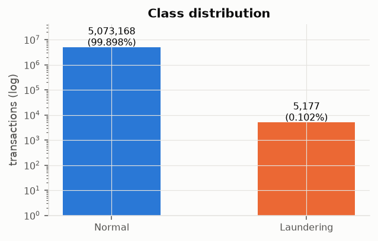 </p>

**A property of the simulator to note:** after 10 September, almost all generated transactions are laundering. 11 September has 396 transactions, of which 232 are laundering. This tail falls inside the test split. See [Limitations](#25-limitations-and-future-work).

## 5. System architecture

```
raw CSV ─► preprocessing (accounts, FX-to-USD, encodings) ─► chronological split
        ─► causal index (strictly-earlier rows per account)
            ├─ edge features (27)          ├─ account-state features (11, before t)
            ├─ sender / receiver histories ├─ temporal neighbour lists (2-hop, before t)
        ─► TemporalGraphStore (on-the-fly batch construction)
        ─► models (TRACE-X + 6 baselines + ablations)  ─► MLflow / checkpoints / metrics.json
        ─► evaluation  ─► explainability  ─► uncertainty / conformal triage
        ─► Streamlit dashboard · FastAPI · investigator reports
```

## 6. Graph construction

- **Nodes** are accounts (`bank_code + "_" + account_hex`). The hex string alone collides across banks.
- **Edges** are directed, time-stamped transactions with 27 attributes:
  - log USD amount and log original amount;
  - payment format (one-hot, 7) and currency (one-hot, 15);
  - cross-bank, currency-conversion and self-loop flags.
- FX rates are estimated from **training** rows only, as the median ratio over cross-currency transactions. Standardisation statistics also come from the training split only.

**Event-time causality.** Timestamps have minute resolution, and 99.7 % of transactions share their minute with another transaction. The order of rows inside a minute is therefore not a real event order, so TRACE-X treats same-minute transactions as **simultaneous**. Everything used to score transaction *e* at time *t* (account states, histories and neighbourhoods at every depth) comes only from transactions with timestamp **strictly < t**.

This is implemented with a vectorised causal index. Rows are sorted by (account, time). For each row, `gs` is the first row of its account group and `bs` is the first row of its (account, timestamp) block. The range `[gs, bs)` is exactly the set of strictly-earlier rows for that account. Full-dataset preprocessing takes about 3 minutes.

**Temporal 2-hop subgraph.** For each (transaction, endpoint) pair, the 10 most recent earlier incident transactions are stored as codes `2·eid + side`. Each neighbour's own list is causal with respect to *its* time, so the lists expand recursively into a bounded 2-hop computation tree (10 + 10×5 neighbours per endpoint) with no future information at any depth.

**Leakage tests.** [tests/test_leakage.py](tests/test_leakage.py) contains 12 tests. They compare the vectorised code with brute-force reference implementations on synthetic data with heavy timestamp ties, and check that features never change when future rows are added.

## 7. Sequence construction

For a target transaction (sender *s* → receiver *r* at time *t*):

- **Sender history:** the last *L* **outgoing** transactions of *s* with timestamp < *t*.
- **Receiver history:** the last *L* **incoming** transactions of *r* with timestamp < *t*.
- Each step has 28 features: the 27 edge features plus a "same counterparty as the target" flag, which captures repeated transfers. Each step also has two time deltas: minutes to the target and minutes to the previous step.
- L = 10 by default. L = 5 and L = 20 are tested in the ablations. Empty histories are handled with packed sequences and a has-history flag.

## 8. Main model: TRACE-X

TRACE-X has five components, all trained end to end with one binary logit output:

1. **Transaction embedding:** *z* = MLP(target edge features).
2. **Graph branch:** two layers of `EdgeTemporalGATConv` over the causal 2-hop subgraph around the sender and the receiver. Messages carry the neighbour state, edge attributes, direction and a learnable time encoding of the lag.
3. **Sequence branches:** separate (unshared) LSTMs over the sender's outgoing and the receiver's incoming histories. Each step's input includes encodings of the time to the target and the time to the previous step.
4. **Temporal branch:** an MLP over time-encoded recency of the sender and receiver, has-history flags, and the cyclic time of day and day of week.
5. **Gated fusion:** element-wise sigmoid gates conditioned on all branches *and* on *z*, followed by a classification head on [fused ‖ *z*].

**What is borrowed and what is new.**

- **Borrowed:** graph attention (Veličković et al., 2018), the dynamic GATv2 scoring function (Brody et al., 2022), and the functional cosine time encoding (Xu et al., 2020, TGAT).
- **This project's design:** the specific combination, which is edge-aware temporal attention over a causal 2-hop neighbourhood, direction-specific sender and receiver LSTMs, an explicit temporal branch, and transaction-conditioned element-wise gating.

TRACE-X is **not** a reproduction of a published Temporal Graph Attention Network or TGN implementation.

## 9. Graph-attention mathematics

Time encoding, with learnable ω, φ ∈ ℝ¹⁶ and ω initialised geometrically from 1 down to 10⁻⁵ per minute:

$$\Phi(\Delta t) = \cos(\omega\,\Delta t + \varphi)$$

Each message from neighbour *j* to account *i* travels over a past transaction with attributes $a_{ij}$, direction $d_{ij}$ and lag $\Delta t_{ij}$. Its edge descriptor is

$$u_{ij} = [\,a_{ij}\,\Vert\,d_{ij}\,\Vert\,\Phi(\Delta t_{ij})\,].$$

For head *h* (GATv2-style scoring):

$$e^{h}_{ij} = \mathbf{a}_h^{\top}\,\mathrm{LeakyReLU}\big(W^{h}_{q}x_i + W^{h}_{k}x_j + W^{h}_{e}u_{ij}\big), \qquad \alpha^{h}_{ij} = \frac{\exp(e^{h}_{ij})}{\sum_{k\in\mathcal N_{<t}(i)}\exp(e^{h}_{ik})}$$

$$m_i = \big\Vert_{h=1}^{H} \sum_{j\in\mathcal N_{<t}(i)} \alpha^{h}_{ij}\,\big(W^{h}_{v}x_j + W^{h}_{u}u_{ij}\big), \qquad x_i' = \mathrm{LayerNorm}\big(x_i + \mathrm{ELU}(W_s x_i + m_i)\big)$$

There are H = 4 heads, hidden size 64 and two layers. Layer 2 only propagates hop-1 → centre edges; a unit test confirms the outputs are identical. The graph representation is

$$r_g = \mathrm{ReLU}\big(W[x'_{s}\,\Vert\,x'_{r}]\big).$$

Attention weights are one internal signal among several. They are **not** used as a complete explanation; see [§17](#17-explainability).

## 10. LSTM and gated-fusion equations

Sender and receiver LSTMs (separate weights). Step input $x_\tau = [\text{step features} \Vert \Phi(\Delta t_{\text{target}}) \Vert \Phi(\Delta t_{\text{prev}})]$:

$$
\begin{aligned}
i_\tau &= \sigma(W_i x_\tau + U_i h_{\tau-1} + b_i) & f_\tau &= \sigma(W_f x_\tau + U_f h_{\tau-1} + b_f)\\
o_\tau &= \sigma(W_o x_\tau + U_o h_{\tau-1} + b_o) & \tilde c_\tau &= \tanh(W_c x_\tau + U_c h_{\tau-1} + b_c)\\
c_\tau &= f_\tau \odot c_{\tau-1} + i_\tau \odot \tilde c_\tau & h_\tau &= o_\tau \odot \tanh(c_\tau)
\end{aligned}
$$

$r_s$ and $r_r$ are the final hidden states of the sender and receiver LSTMs.

Gated fusion over the branches $k \in \{g, s, r, t\}$:

$$g_k = \sigma\big(W^{k}_{g}[\,r_g \Vert r_s \Vert r_r \Vert r_t \Vert z\,] + b^{k}_{g}\big), \qquad f = \sum_k g_k \odot \tanh(W_k r_k + b_k)$$

$$\hat y = w_2^{\top}\,\mathrm{Dropout}\big(\mathrm{ReLU}(W_1[f \Vert z] + b_1)\big) + b_2 \quad(\text{logit};\ p = \sigma(\hat y))$$

## 11. Architecture diagram

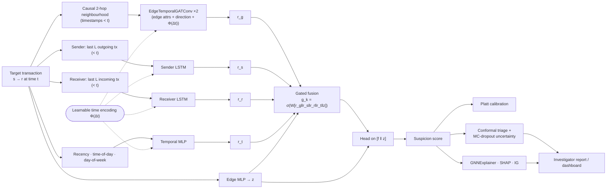

## 12. Baselines

All baselines use the same splits, the same causal inputs, the target-transaction embedding *z*, hidden size 64, the same optimiser, loss, epoch budget and early-stopping rule. No classical ML classifiers are used.

| Model | Description | Params |
|---|---|---|
| LSTM | One shared LSTM over the sender and receiver histories (log Δt as a scalar); no graph | 42,945 |
| GRU | Same as LSTM, with a GRU cell | 36,801 |
| GCN | Two `GCNConv` layers over the same causal 2-hop subgraph (cannot use edge attributes) (Kipf & Welling, 2017) | 27,713 |
| GraphSAGE | Two `SAGEConv` layers (mean aggregation) over the same subgraph (Hamilton et al., 2017) | 35,905 |
| GAT | Two `GATConv` layers with `edge_dim` (edge features, direction, log Δt) (Veličković et al., 2018) | 31,809 |
| GAT-LSTM | GAT encoder plus shared LSTM, plain concatenation; no gating, no temporal branch, no learnable time encoding | 64,577 |
| **TRACE-X** | Proposed model (§8) | 238,369 |

## 13. Experimental methodology

- **Chronological split** by transaction count. The boundaries are snapped to timestamp changes, so no minute straddles two splits:

  | Split | Transactions | Laundering | Period | Purpose |
  |---|---|---|---|---|
  | train | 3,047,216 | 2,299 | 09-01 → 09-06 13:36 | gradient updates, FX rates, standardisers |
  | val_select | 508,115 | 558 | 09-06 → 09-07 14:56 | early stopping, model selection, F1-optimal threshold |
  | val_cal | 507,450 | 523 | 09-07 → 09-08 16:12 | Platt scaling, conformal calibration, MC-dropout threshold |
  | test | 1,015,564 | 1,797 | 09-08 16:13 → 09-18 | **scored once**, after every choice was fixed |

- **Class imbalance:**
  - Each epoch uses all 2,299 training positives plus 150,000 freshly resampled negatives.
  - Loss is BCE-with-logits with `pos_weight = n_neg/n_pos` (about 65). Focal loss is implemented and available as an option.
- **Optimisation:**
  - AdamW (lr 1e-3, weight decay 1e-4), gradient clipping at 1.0.
  - ReduceLROnPlateau (factor 0.5, patience 1) on validation PR-AUC.
  - Early stopping with patience 3, at most 20 epochs. The best checkpoint is restored.
  - AMP is enabled only on CUDA. This laptop has no CUDA GPU, and its CPU has no native bf16.
- **Validation PR-AUC** per epoch uses all val_select positives plus a fixed 50 k negative sample, weighted by inverse sampling rate (Horvitz–Thompson). A unit test checks that this reproduces full-population metrics.
- **Seeds:** 0, 1 and 2 for every model. Ablations use seed 0, plus seed 1 for the four key ablations (sequence-only, graph-only, concat fusion, no temporal encoding). This was a compute budget decision.
- **Nothing was tuned on the test split.** Hyper-parameters are fixed in [configs/](configs/). Test predictions are made once per run.
- **Hardware:** AMD Ryzen 7 5800H (8 cores), 15.4 GB RAM, no CUDA GPU. torch 2.x (CPU) and PyTorch Geometric. Two training jobs often shared the CPU, so wall-clock training times are only indicative. Controlled efficiency numbers come from a separate benchmark (§15).
- **Tracking:** every run logs its configuration, seed, per-epoch metrics, test metrics, duration and checkpoint path to MLflow (`sqlite:///mlflow.db`) and to `experiments/full/<exp>/seed<k>/`.

## 14. Evaluation metrics

All test metrics are computed on the **complete** test split (1,015,564 transactions).

- **ROC-AUC** and **PR-AUC** (average precision). PR-AUC is the primary metric because positives are extremely rare.
- **Precision, recall and F1** at the threshold that maximises F1 on val_select.
- **Alert budget:** rank all test transactions and take the top K = 0.5 %, 1 % and 2 % of them.
  - Precision@K = hits / K.
  - Recall@K = hits / all test positives.
  - At 0.5 %, K = 5,078 alerts for 1,797 true positives, so P@0.5 % is at most 0.354.
- **Calibration:** Brier score, ECE (15 bins) and reliability diagrams, for raw probabilities and Platt-scaled probabilities (fitted on val_cal).
- **Efficiency:** parameters, training time, inference throughput, single-transaction latency (including causal batch construction) and peak memory.

## 15. Results

Source: [reports/results/results_models.md](reports/results/results_models.md). Mean ± std over **3 seeds**, full test split.

| Model | ROC-AUC | **PR-AUC** | Precision | Recall | F1 | P@0.5 % | R@0.5 % |
|---|---|---|---|---|---|---|---|
| LSTM | 0.9873 ± 0.0001 | 0.3907 ± 0.0085 | 0.3311 ± 0.0306 | 0.4485 ± 0.0256 | 0.3790 ± 0.0137 | 0.2041 ± 0.0019 | 0.5769 ± 0.0054 |
| GRU | 0.9878 ± 0.0004 | 0.3810 ± 0.0142 | 0.4043 ± 0.0152 | 0.3882 ± 0.0204 | 0.3957 ± 0.0134 | 0.2099 ± 0.0026 | 0.5932 ± 0.0075 |
| GCN | 0.9845 ± 0.0006 | 0.2764 ± 0.0123 | 0.2768 ± 0.0167 | 0.4389 ± 0.0561 | 0.3368 ± 0.0090 | 0.1998 ± 0.0075 | 0.5646 ± 0.0211 |
| GraphSAGE | 0.9860 ± 0.0002 | 0.2751 ± 0.0159 | 0.2796 ± 0.0493 | 0.4786 ± 0.0829 | 0.3428 ± 0.0101 | 0.2116 ± 0.0011 | 0.5980 ± 0.0030 |
| GAT | 0.9843 ± 0.0008 | 0.2636 ± 0.0345 | 0.2489 ± 0.0300 | 0.4808 ± 0.0283 | 0.3267 ± 0.0275 | 0.2026 ± 0.0118 | 0.5726 ± 0.0332 |
| GAT-LSTM | **0.9895 ± 0.0002** | 0.4843 ± 0.0020 | 0.4248 ± 0.0158 | **0.4981 ± 0.0138** | 0.4580 ± 0.0047 | 0.2352 ± 0.0035 | 0.6646 ± 0.0100 |
| **TRACE-X** | 0.9890 ± 0.0007 | **0.4857 ± 0.0386** | **0.4554 ± 0.0603** | 0.4945 ± 0.0182 | **0.4721 ± 0.0362** | **0.2404 ± 0.0066** | **0.6795 ± 0.0186** |

TRACE-X per-seed test PR-AUC: **0.5391 / 0.4495 / 0.4683** (seeds 0 / 1 / 2).

**How to read this table:**

- **Temporal and sequential information matters most.** Every model that sees account histories (LSTM, GRU, GAT-LSTM, TRACE-X) beats every graph-only GNN by a wide margin in PR-AUC (0.38–0.49 vs 0.26–0.28).
- **Hybrids are better than either family alone.** GAT-LSTM and TRACE-X improve on the best sequence-only baseline (LSTM) by about 0.09 PR-AUC, and they also come first at the 0.5 % alert budget. At that budget TRACE-X finds about 68 % of the test laundering transactions, against 58 % for LSTM.
- **TRACE-X vs GAT-LSTM is a statistical tie on PR-AUC** (0.486 ± 0.039 vs 0.484 ± 0.002). TRACE-X has the best seed of any model (0.539) and the highest mean F1, P@K and R@K, but it is much less stable across seeds. Two of its three seeds early-stopped at epochs 3–4.
  - With three seeds we cannot claim TRACE-X is significantly better than the simpler concatenation hybrid.
  - It has 3.7× more parameters. In the controlled benchmark its single-transaction latency is 1.3× higher (11.3 vs 8.8 ms), while batch throughput is similar.
- ROC-AUC is saturated near 0.99 for every model and does not separate them. PR-AUC and alert-budget recall are the informative metrics.

<p align="center">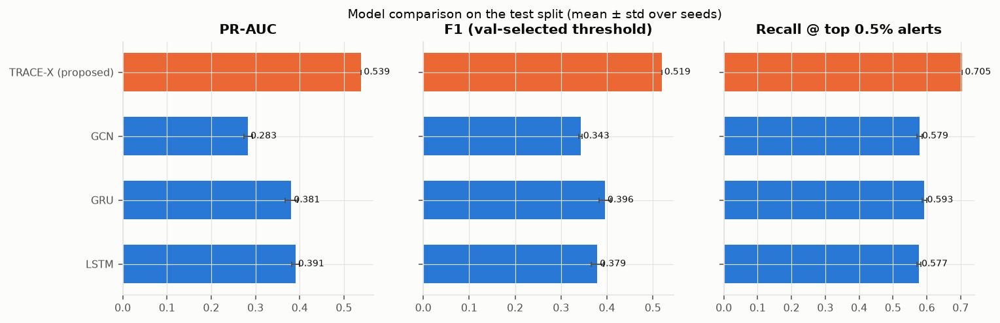</p>
<p align="center">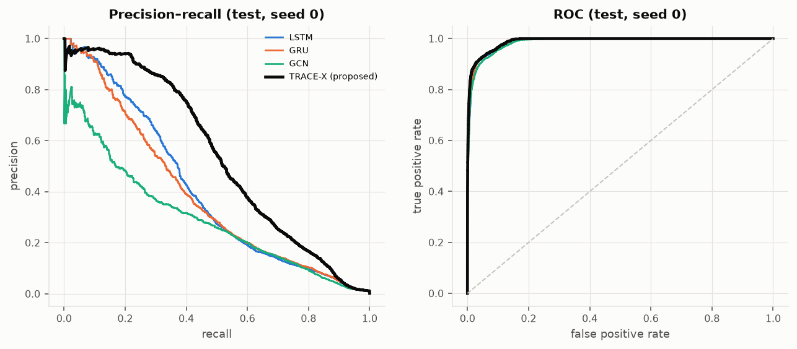 </p>

**Calibration (test, mean over seeds).** Raw scores are badly calibrated, as expected from training with `pos_weight` ≈ 65 on resampled data. TRACE-X raw: Brier 0.068, ECE 0.097. Platt scaling on val_cal fixes this for all models: TRACE-X Brier 0.00123, ECE 0.0006. Figure: [calibration_tracex.png](reports/results/figures/calibration_tracex.png).

**Efficiency.** Controlled benchmark ([scripts/benchmark_efficiency.py](scripts/benchmark_efficiency.py)): each model run alone in a fresh process, 8 CPU threads, identical batches.

| Model | Params | Train samples/s | Est. min/epoch | Inference tx/s | Latency median / p95 (ms) | Peak memory (MB) |
|---|---|---|---|---|---|---|
| LSTM | 42,945 | 1,311 | 1.9 | 15,775 | 6.1 / 11.3 | 1,178 |
| GRU | 36,801 | 7,286 | 0.3 | 22,134 | 3.4 / 3.8 | 1,155 |
| GCN | 27,713 | 754 | 3.4 | 2,200 | 8.7 / 27.2 | 2,614 |
| GraphSAGE | 35,905 | 2,473 | 1.0 | 2,744 | 2.9 / 6.2 | 2,404 |
| GAT | 31,809 | 1,147 | 2.2 | 1,459 | 6.3 / 7.7 | 2,814 |
| GAT-LSTM | 64,577 | 1,004 | 2.5 | 1,356 | 8.8 / 11.5 | 2,953 |
| **TRACE-X** | 238,369 | 1,176 | 2.2 | 1,568 | 11.3 / 17.3 | 3,070 |

Notes on the efficiency numbers:

- **Latency** is for one transaction and *includes* building its causal history and 2-hop subgraph. Inference throughput is for batches of 4,096.
- **Bottleneck:** building the causal subgraph on the CPU is probably the main cost for every graph-based model. That would explain why TRACE-X is not much slower than the much smaller GAT. This breakdown was not profiled separately.
- **Source:** [reports/results/efficiency_benchmark.json](reports/results/efficiency_benchmark.json). The benchmark was run once, so small differences (for example LSTM vs GRU training speed) are within run-to-run noise.
- **Full experiment timings:** epochs took longer during the experiments because two jobs shared the CPU. Training times recorded during the experiment queues are in `results_models.md` and are indicative only.

## 16. Ablation results

Source: [reports/results/results_ablation.md](reports/results/results_ablation.md). TRACE-X itself varies by ±0.04 PR-AUC across seeds, so each ablation is compared with the TRACE-X run that used **the same seed** ("paired Δ"). Single-seed differences smaller than about 0.04 should be read as noise.

| Variant | Seeds | PR-AUC | F1 | R@0.5 % | Params | Paired ΔPR-AUC |
|---|---|---|---|---|---|---|
| **TRACE-X (full)** | 3 | 0.4857 ± 0.0386 | 0.4721 ± 0.0362 | 0.6795 ± 0.0186 | 238,369 | — |
| Sequence branches only (no graph, no temporal branch) | 2 | 0.4573 ± 0.0015 | 0.4693 ± 0.0011 | 0.6297 ± 0.0075 | 111,873 | −0.037 |
| Graph branch only | 2 | 0.4812 ± 0.0200 | 0.4747 ± 0.0261 | 0.6728 ± 0.0017 | 80,705 | −0.013 |
| w/o learnable temporal encoding | 2 | 0.4970 ± 0.0162 | 0.4698 ± 0.0214 | 0.6664 ± 0.0003 | 175,361 | +0.003 |
| w/o edge features in the graph | 1 | 0.5669 | 0.5470 | 0.7034 | 231,201 | +0.028 |
| w/o graph attention (mean aggregation) | 1 | 0.3049 | 0.3268 | 0.5537 | 216,097 | −0.234 |
| w/o sender history | 1 | 0.5285 | 0.5107 | 0.7140 | 169,089 | −0.011 |
| w/o receiver history | 1 | 0.5297 | 0.5052 | 0.6989 | 169,089 | −0.009 |
| Concatenation instead of gated fusion | 2 | 0.4175 ± 0.0052 | 0.4299 ± 0.0030 | 0.6784 ± 0.0033 | 151,841 | −0.077 |
| Sequence length 5 (default 10) | 1 | 0.5538 | 0.5107 | 0.7257 | 238,369 | +0.015 |
| Sequence length 20 | 1 | 0.5404 | 0.5180 | 0.7245 | 238,369 | +0.001 |

<p align="center">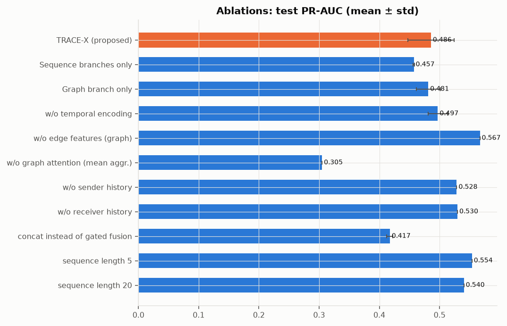</p>

**Findings:**

- **Gated fusion is the only component with a consistent effect.** Replacing it with concatenation lowered PR-AUC on **both** seeds: 0.412 vs 0.539 on seed 0, and 0.423 vs 0.450 on seed 1 (paired −0.077).
- **Combining branches helps, but not consistently.**
  - Sequence-only and graph-only are lower than the full model on seed 0 (−0.08 for each) but slightly higher on seed 1 (+0.006 and +0.05). The paired means are −0.037 and −0.013.
  - The combination is better on average, but with 2 seeds this is not conclusive. Most of the seed-1 gap comes from that TRACE-X seed stopping early at epoch 3.
  - A clearer result: the edge-aware temporal graph branch on its own (0.481) is far stronger than the standalone GNN baselines (0.26–0.28). Edge attributes, direction and lag-aware messages over the causal neighbourhood matter more than the GNN family used.
- **Mean aggregation instead of attention gave the largest drop** (−0.23). However, this single run reached its best validation score at epoch 1 and then stopped improving, which suggests an optimisation failure as much as a benefit of attention. More seeds are needed before drawing a conclusion.
- **No measurable effect within seed noise:**
  - the learnable time encoding (+0.003; both seeds within the TRACE-X spread);
  - removing one history branch (sender or receiver, about −0.01);
  - sequence length 5 or 20 instead of 10 (+0.015 / +0.001).

  These components cannot be shown to help at this compute budget. The time-encoding result means the sequence branches already capture recency through Δt inputs and the temporal branch.
- **Removing graph edge features did not hurt** (+0.028, one seed, inside the seed spread). The transaction's own attributes already enter through *z*, the sequence steps and the temporal branch.
- **Overall:**
  - **Gated fusion** clearly earns its place.
  - **Combining graph and sequence evidence** is supported on average but not on every seed.
  - **The other components** (time encoding, edge features in the graph, two separate history branches, sequence length) are neutral within noise at this compute budget.
  - The biggest weakness of TRACE-X is **seed instability**, not missing capacity.

## 17. Explainability

Three complementary methods are applied to the **actual trained TRACE-X model** (seed 0), using the same inputs and the same forward pass as the prediction:

| Method | What it explains | Notes |
|---|---|---|
| **GNNExplainer** (adapted; Ying et al., 2019) | Which past transactions (edges) in the causal 2-hop subgraph, and which edge and account features, the graph branch relies on | Soft masks multiply messages inside `EdgeTemporalGATConv`. Objective: predicted-class log-likelihood plus size and entropy penalties |
| **Kernel SHAP** (Lundberg & Lee, 2017) | 31 interpretable features: transaction attributes, sender and receiver account state, time | Histories and neighbourhood held fixed. Background: 12 training transactions. Additivity checked |
| **Integrated Gradients** (Sundararajan et al., 2017) | Each historical transaction in the sender and receiver sequences, plus per-feature totals | 64-step trapezoid rule, zero baseline in standardised space. Completeness checked per case |

**Quality evaluation** on 10 test cases (5 true positives, 2 false positives, 2 false negatives, 1 true negative). Fidelity is measured in **logit units**, signed towards the predicted class. Probabilities saturate near 1, so fidelity measured in probability space would read 0 for confident alerts.

| Method | Delete top-k → logit drop | Delete random k → logit drop | Sparsity | Sanity check |
|---|---|---|---|---|
| Kernel SHAP | **9.94 ± 3.88** | 0.68 ± 0.31 | top-5 features carry 83 % of \|attribution\| | additivity gap 2e-7 |
| Integrated Gradients | **0.89 ± 0.71** | 0.29 ± 0.18 | top-3 steps carry 41 % | completeness \|Δ\| 0.001 |
| GNNExplainer | −0.03 ± 0.08 (fid⁺) | 0.01 ± 0.02 | 0 % of edges have mask > 0.5 | — |

**Stability across seeds.** These compare explanations of the same 4 transactions from TRACE-X seeds 0, 1 and 2 (12 pairs):

| Method | Spearman ρ | Top-k Jaccard |
|---|---|---|
| Kernel SHAP (31 features) | 0.68 ± 0.15 | top-5: 0.62 ± 0.16 |
| Integrated Gradients (history steps) | 0.68 ± 0.25 | top-3: 0.67 ± 0.37 |
| GNNExplainer (edges) | 0.996 ± 0.009 | top-5: 1.00 |

SHAP and IG are moderately stable: independently trained models mostly agree on the main drivers but differ in the details. The near-perfect GNNExplainer "stability" is **not** a sign of quality. The masks are almost uniform, so their ranking is driven mostly by the size and entropy regularisers, not by the model.

**What the explanations show, and what they do not:**

- **SHAP and IG explanations are faithful by these tests.** Removing the features or history steps they rank highest changes the score much more than removing random ones (14× for SHAP, 3× for IG).
- **Globally**, the most important features (mean |SHAP| over 40 test transactions) are `payment_format`, `log_usd_paid` and `sender_log_minutes_since_last`. This matches the data profile: ACH carries most laundering, and laundering amounts are larger.
- **GNNExplainer does not find a sparse graph explanation.** Its masks are diffuse: no edge exceeds 0.5, and many edges receive almost identical weights of about 0.09. Deleting its top-k edges does not reduce the score more than deleting random edges. Removing the *whole* neighbourhood lowers the logit by only 0.1–1.9.
  - This is consistent with the ablations: the model's evidence comes mostly from the transaction itself and the account histories, while the graph contribution is spread across many neighbours.
  - The GNNExplainer output is reported as found. It should not be read as pointing to specific accomplice accounts.
- **Possible shortcut:** `day_of_week` has a positive SHAP contribution in several alerts. In this synthetic benchmark, the tail days of the test period are dominated by laundering (§4), so the model may partly exploit a simulator artefact. This would not carry over to real data.
- Attention weights are **not** presented as explanations.
- No explanation establishes that a transaction is criminal.

Example investigator report (true positive): [reports/explanations/cases/4723765.md](reports/explanations/cases/4723765.md). Every report has the same structure: transaction details, causal account history, SHAP drivers, IG-attributed history steps, GNNExplainer neighbours, uncertainty and the disclaimer.

<p align="center">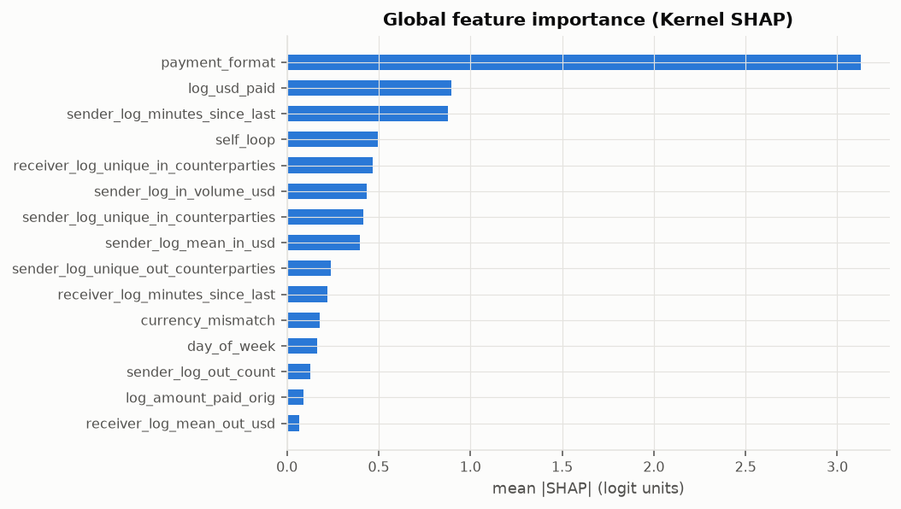 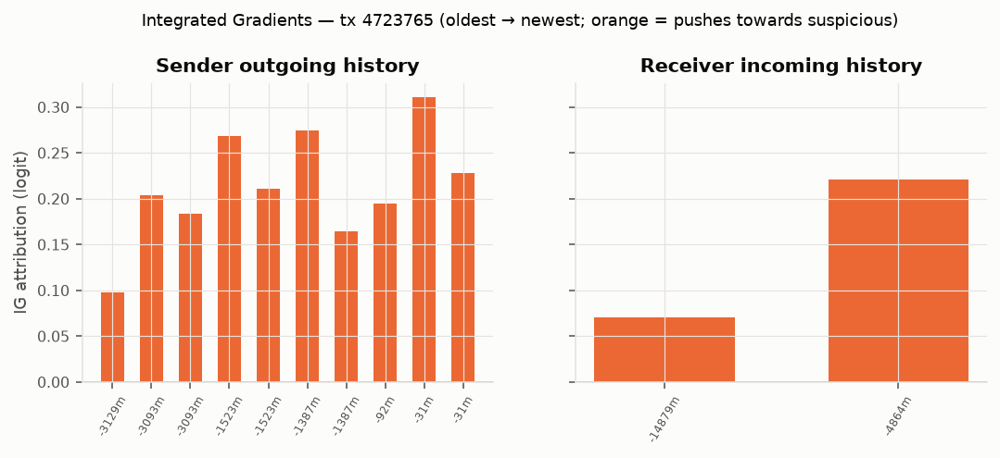</p>

## 18. Uncertainty and human review

Source: [reports/uncertainty/uncertainty.md](reports/uncertainty/uncertainty.md). Model: TRACE-X seed 0.

**Class-conditional split conformal prediction**, calibrated on val_cal. α₀ = 0.01 for normal transactions and α₁ = 0.1 for laundering, fixed in advance as a policy choice (not tuned on test). Each test transaction gets {normal}, {suspicious}, or *both/neither* → human review.

| Quantity (full test split) | Value |
|---|---|
| Coverage, normal (target 0.99) | 0.9737 |
| Coverage, laundering (target 0.90) | 0.9432 |
| Confident normal / confident suspicious / human review | 92.9 % / 2.78 % / 4.35 % |

Coverage for normal transactions falls short of its target (0.974 vs 0.99). This is expected under temporal drift: the calibration period precedes the test period, so exchangeability does not hold. It is reported rather than hidden. The confident-suspicious set (2.8 % of traffic) still contains 94 % of laundering transactions. That is too many alerts for a real deployment, which would use the alert-budget ranking instead.

**MC Dropout** (T = 20, test subsample with IPW weights): a transaction goes to review when its predictive std exceeds the 95th percentile on val_cal. This happens for 8.0 % of traffic. The MC std detects misclassified transactions with AUROC 0.813, so the model's uncertainty is informative about its own errors.

## 19. Dashboard

A Streamlit app with a dark navy theme, Plotly charts and PyVis networks. It has six pages and reads only saved artefacts and the trained checkpoint; nothing on it is invented. Every page shows the disclaimer.

| Page | Contents |
|---|---|
| Overview | Dataset and test KPIs, transactions and laundering per day, payment formats, test score distribution, model performance summary, highest-risk test transactions |
| Transaction Investigation | Look up any transaction: score, calibrated probability, conformal outcome, the sender and receiver histories fed to the LSTMs, IG and SHAP explanations |
| Network Explorer | Bounded causal ego network around an account, coloured by model score |
| Explainable AI | GNNExplainer subgraph, SHAP bars and IG history attributions for any transaction (precomputed or computed live) |
| Model Laboratory | Baseline and ablation comparisons, training curves, efficiency |
| Investigation Reports | Generates the investigator report (Markdown or HTML download) |

| | |
|---|---|
| 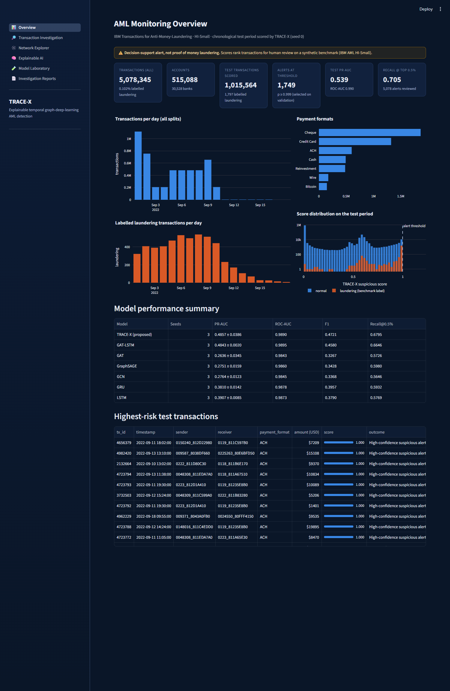 | 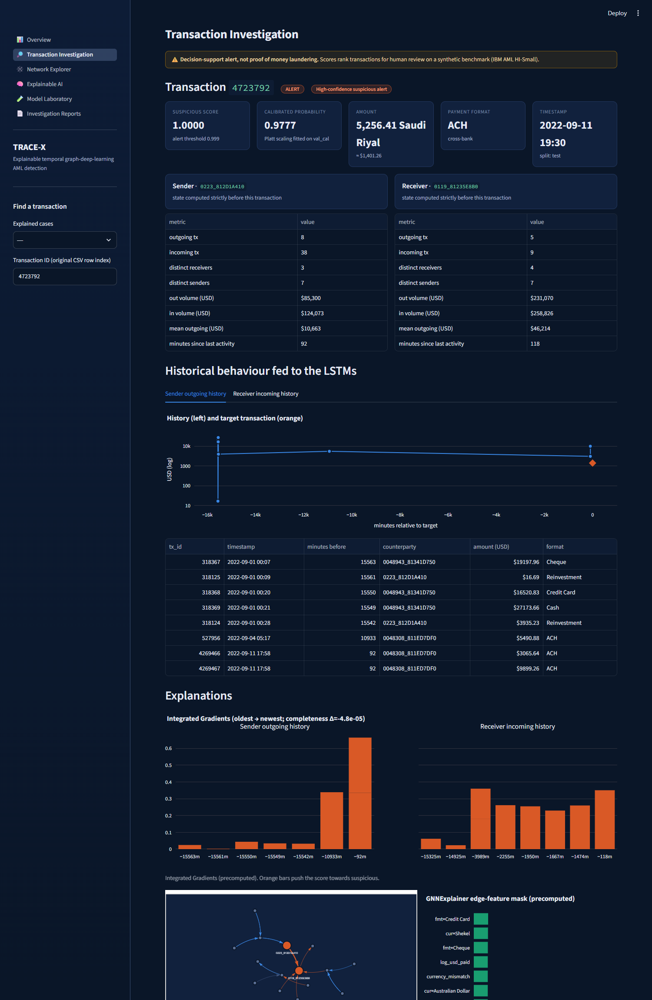 |
| 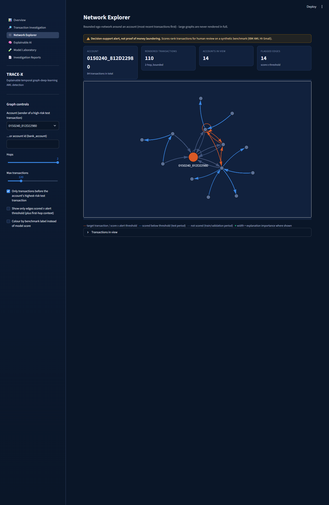 | 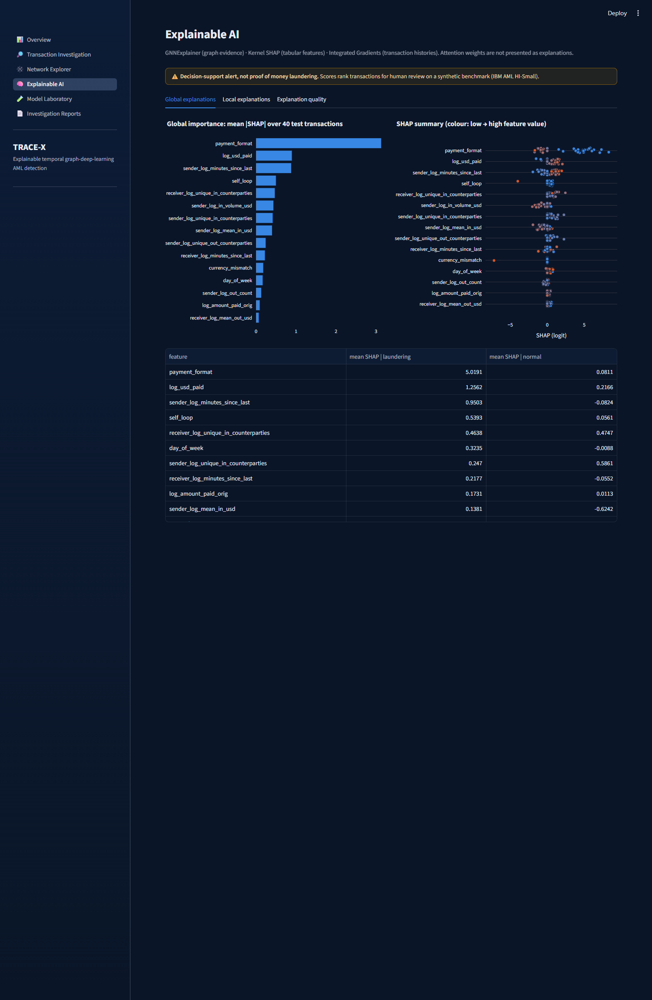 |
| 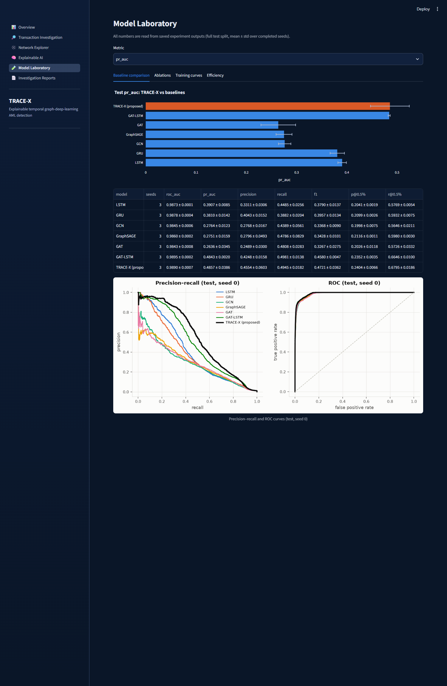 |  |

## 20. Installation

Requirements: Python 3.11–3.13 and about 16 GB RAM for full mode. A GPU is optional; the code uses CUDA if it is available.

```bash
git clone <this-repo> && cd Anti-Money_Laundering
python -m venv .venv && source .venv/bin/activate   # Windows: .venv\Scripts\activate
pip install -r requirements.txt
cp .env.example .env    # optional: Kaggle credentials / raw-file path, read from environment variables only
```

The dataset is downloaded with `kagglehub` the first time it is needed. You can also put `HI-Small_Trans.csv` in `data/raw/`, or set `TRACEX_RAW_FILE=/path/to/HI-Small_Trans.csv`. No credentials are stored in the repository.

## 21. Training and evaluation

[scripts/reproduce.sh](scripts/reproduce.sh) runs everything in order. The individual steps:

```bash
# data (full: ~3 min, ~2.5 GB of cached arrays in data/processed/)
python -m src.data.pipeline --mode full          # use --mode dev for a 600k-row chronological prefix
python -m src.data.profiling --mode full

# one experiment (configs/models.yaml lists all experiment names)
python -m src.training.run_experiment --exp tracex --seed 0 --mode full

# experiment queues (resumable; skips runs that already have metrics.json)
python scripts/run_queue.py --exps tracex,lstm,gru,gcn,graphsage,gat,gat_lstm --seeds 0,1,2

# tables and figures from every completed run
python -m src.evaluation.comparison --mode full

# explanations, uncertainty and the controlled efficiency benchmark
python scripts/explain.py --exp tracex --seed 0 --stability-seeds 1,2
python scripts/uncertainty.py --exp tracex --seed 0
python scripts/benchmark_efficiency.py

# experiment tracking UI
mlflow ui --backend-store-uri sqlite:///mlflow.db
```

Measured on the laptop described in §13 (often with two jobs sharing the CPU):

- Sequence baselines take a few minutes per run.
- Graph models take 1–1.5 h per run.
- TRACE-X takes about 1.5 h per run.

## 22. Running the dashboard and API

```bash
streamlit run dashboard/app.py                    # http://localhost:8501
python scripts/screenshots.py                     # optional: re-capture screenshots (needs playwright + Chrome)

uvicorn src.api:app --port 8000                   # GET /health, /predict/{tx_id}, /explain/{tx_id}
docker build -t tracex .
docker run -p 8501:8501 -v $PWD/data:/app/data -v $PWD/checkpoints:/app/checkpoints \
           -v $PWD/experiments:/app/experiments -v $PWD/reports:/app/reports tracex
```

Verification status:

- **API:** `/health`, `/predict/{tx_id}` and `/explain/{tx_id}` were smoke-tested with FastAPI's TestClient. Unknown IDs return 404.
- **Docker:** the image was built with Docker Desktop 29.9.3 on 18 Nov 2026 (2.81 GB, CPU-only PyTorch).
  - Dashboard container: all 6 pages loaded with no errors.
  - API container (`docker run ... tracex uvicorn src.api:app --host 0.0.0.0 --port 8000`): returned the same prediction as the non-container run (tx 4723765: score 0.99995, calibrated 0.8972), and 404 for unknown IDs.

The dashboard and API need the processed data (`data/processed/full`) and a checkpoint (`checkpoints/full/tracex/seed0.pt`). Both are produced by the steps above; neither is committed.

## 23. Tests

```bash
python -m pytest tests -q
```

**Result (18 Nov 2026): 42 passed, 0 failed** in about 30 s. The tests use the dev-mode artefacts: a 600k-row chronological prefix plus a 1-epoch dev checkpoint, both created by `scripts/reproduce.sh`. The suite has 12 leakage tests, 21 model tests, 3 training tests and 6 explainability tests.

The suite covers:

- dataset loading;
- leakage prevention (vectorised features vs brute force, invariance to future rows);
- graph construction and causal neighbour lists;
- sequence generation;
- model output shapes and forward/backward passes for every architecture and ablation;
- the depth-pruning equivalence;
- checkpoint save and restore;
- prediction consistency;
- IPW metric correctness;
- explanation generation (SHAP additivity, IG completeness).

## 24. Repository layout

```
configs/            data.yaml · training.yaml · models.yaml (all experiments and ablations)
src/data/           download, preprocessing, profiling, cached pipeline
src/graph/          causal index, features, static/temporal graph construction, TemporalGraphStore
src/sequences/      sender/receiver histories, time encoding
src/models/         layers (EdgeTemporalGATConv, GatedFusion…), TRACE-X, baselines, registry
src/training/       trainer, losses, checkpoints, run_experiment
src/evaluation/     metrics, alert budget, calibration, comparison
src/explainability/ GNNExplainer, SHAP, Integrated Gradients, fidelity, investigator reports
src/uncertainty/    MC dropout, conformal
src/api.py          FastAPI service
dashboard/          Streamlit app (6 pages + components)
scripts/            queues, explanation/uncertainty/benchmark/screenshot scripts, reproduce.sh
tests/              pytest suite
reports/            profiling, results tables and figures, explanations, uncertainty, screenshots
experiments/full/   per-run config, history, metrics.json and logs (predictions are git-ignored)
docs/               methodology.md
```

## 25. Limitations and future work

**Limitations:**

- **Synthetic benchmark.** HI-Small is generated by an agent-based simulator with known typologies. Results show how well a model learns *these* simulated patterns, not real-world AML performance. The late test period is dominated by laundering, which is a simulator artefact the model may partly exploit (see the `day_of_week` SHAP finding).
- **Extreme class imbalance** (0.1 %). At the F1-optimal threshold, about half of the alerts are false positives. PR-AUC below 0.55 means substantial manual review would still be needed.
- **Compute.** Training ran on a CPU-only laptop:
  - Ablations have 1–2 seeds, and hyper-parameters were not searched.
  - TRACE-X's seed variance is high. Two seeds stopped at epochs 3–4 with patience 3, so a longer patience or a learning-rate warm-up would probably help.
  - With 3 seeds, TRACE-X and GAT-LSTM cannot be separated statistically.
- **Temporal generalisation.** There is one chronological split. Conformal coverage for normal transactions fell below its target on test, a sign of drift between the calibration and test periods. A rolling-origin evaluation would be more convincing.
- **Explainability.**
  - SHAP holds the history and neighbourhood fixed, so it explains only tabular features.
  - IG depends on the choice of baseline.
  - GNNExplainer produced diffuse, non-informative graph masks. Investigator reports now flag this automatically.
  - SHAP and IG explanations are only moderately stable across seeds (Spearman ≈ 0.68).
  - None of these methods shows causation.
- **Deployment.** The model is not trained on, or validated against, real bank data. Investigators would need governance, model-risk validation, privacy controls and drift monitoring. The system is a decision-support tool and must not trigger automated action against customers.

**Future work:**

- Rolling-window evaluation and multiple test periods.
- Learning-rate warm-up, longer patience and seed ensembling to stabilise TRACE-X.
- Comparison with memory-based temporal GNNs such as TGN (Rossi et al., 2020) and with the multi-GNN baselines of the dataset paper.
- Evaluation on the HI-Medium and LI variants.
- Explanation methods for temporal graphs (for example, subgraph-level counterfactuals).
- Online and streaming scoring.

## 26. References

1. Altman, E., Blanuša, J., von Niederhäusern, L., Egressy, B., Anghel, A., & Atasu, K. (2023). Realistic Synthetic Financial Transactions for Anti-Money Laundering Models. *Advances in Neural Information Processing Systems 36 (NeurIPS 2023), Datasets and Benchmarks Track*. arXiv:2306.16424.
2. Veličković, P., Cucurull, G., Casanova, A., Romero, A., Liò, P., & Bengio, Y. (2018). Graph Attention Networks. *ICLR 2018*. arXiv:1710.10903.
3. Brody, S., Alon, U., & Yahav, E. (2022). How Attentive are Graph Attention Networks? *ICLR 2022*. arXiv:2105.14491.
4. Hamilton, W. L., Ying, R., & Leskovec, J. (2017). Inductive Representation Learning on Large Graphs. *NeurIPS 2017*. arXiv:1706.02216.
5. Kipf, T. N., & Welling, M. (2017). Semi-Supervised Classification with Graph Convolutional Networks. *ICLR 2017*. arXiv:1609.02907.
6. Xu, D., Ruan, C., Korpeoglu, E., Kumar, S., & Achan, K. (2020). Inductive Representation Learning on Temporal Graphs. *ICLR 2020*. arXiv:2002.07962.
7. Rossi, E., Chamberlain, B., Frasca, F., Eynard, D., Monti, F., & Bronstein, M. (2020). Temporal Graph Networks for Deep Learning on Dynamic Graphs. arXiv:2006.10637. (Cited as related work; not implemented.)
8. Hochreiter, S., & Schmidhuber, J. (1997). Long Short-Term Memory. *Neural Computation*, 9(8), 1735–1780.
9. Cho, K., van Merriënboer, B., Gulcehre, C., Bahdanau, D., Bougares, F., Schwenk, H., & Bengio, Y. (2014). Learning Phrase Representations using RNN Encoder–Decoder for Statistical Machine Translation. *EMNLP 2014*. arXiv:1406.1078.
10. Ying, R., Bourgeois, D., You, J., Zitnik, M., & Leskovec, J. (2019). GNNExplainer: Generating Explanations for Graph Neural Networks. *NeurIPS 2019*. arXiv:1903.03894.
11. Sundararajan, M., Taly, A., & Yan, Q. (2017). Axiomatic Attribution for Deep Networks. *ICML 2017*. arXiv:1703.01365.
12. Lundberg, S. M., & Lee, S.-I. (2017). A Unified Approach to Interpreting Model Predictions. *NeurIPS 2017*. arXiv:1705.07874.
13. Gal, Y., & Ghahramani, Z. (2016). Dropout as a Bayesian Approximation: Representing Model Uncertainty in Deep Learning. *ICML 2016*. arXiv:1506.02142.
14. Angelopoulos, A. N., & Bates, S. (2021). A Gentle Introduction to Conformal Prediction and Distribution-Free Uncertainty Quantification. arXiv:2107.07511.
15. Platt, J. (1999). Probabilistic Outputs for Support Vector Machines and Comparisons to Regularized Likelihood Methods. *Advances in Large Margin Classifiers*, MIT Press.
16. Guo, C., Pleiss, G., Sun, Y., & Weinberger, K. Q. (2017). On Calibration of Modern Neural Networks. *ICML 2017*. arXiv:1706.04599.

---

*TRACE-X is an academic project. Its outputs are decision-support alerts, not proof of money laundering.*
